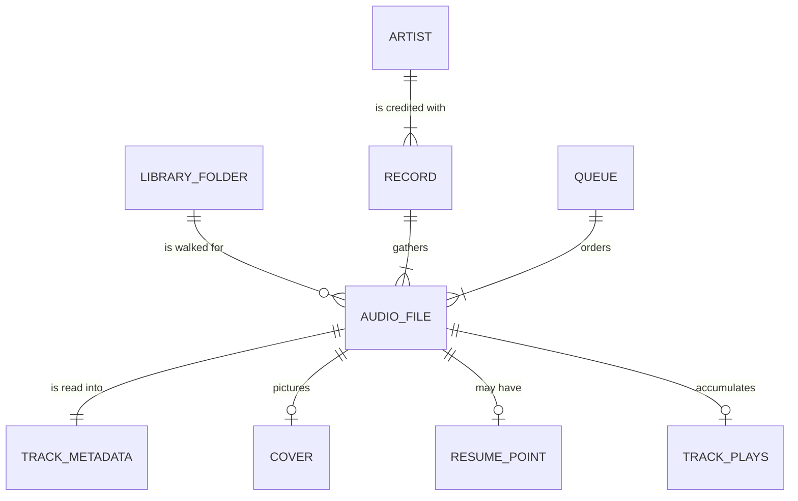

# Business Rules — Orpheus

The domain this application reasons about, and the rules it holds itself to.
Rules are `BR-xx` and are referenced by the requirements and the use cases.

## 1. Entities

| Entity | What it is |
| --- | --- |
| **Library folder** | A directory on disk the owner registered as a source. Several may exist. Stored as a path. |
| **Audio file** | One file with a supported extension found under a library folder. Identified by its absolute path. |
| **Track metadata** | What the file's tags say: title, artist, album artist, album, genres (none, one or several), track and disc numbers, year, duration, and the id of its cover. Every field is optional. |
| **Cover** | A picture extracted at scan time, addressed by a hash of its bytes. |
| **Record** | Not stored. A grouping derived from the files that share an album and an album artist. |
| **Artist** | Not stored. A grouping derived from the album artist. |
| **Genre** | Not stored. A grouping derived from the genres the tracks carry; a track with several is in each, and a track with none is in the *No genre* group. |
| **Queue** | What is playing and in what order. Lives for a session; never persisted. |
| **Resume point** | Where playback stopped in one file. |
| **Track plays** | How many times one file has counted as played, and when it last did. |

## 2. Identity and ownership

**BR-01 — A track is identified by its absolute path.** There is no catalog
server to mint an id and no database to hold one, and a path is what every other
part of the application must have anyway.

> *Consequence, stated rather than hidden:* moving a file makes it a different
> track to this application. Its resume point and its play count do not follow
> it. Re-scanning is what reconciles that.

**BR-02 — The owner's audio files are read, and written only to change their
tags, for changes the owner confirmed or started.** No file is renamed, moved, deleted or
transcoded. Everything this application produces lives in its own directory,
with two exceptions. The first is the `.lrc` a lyrics lookup writes beside a
track (`BR-29a`): a new file next to the audio, never a change to the audio, and
never a replacement for a sidecar the owner wrote. The second is the tags of an
MP3 or FLAC file, changed by an autofill (`FR-AF-05`) — and only for the
changes the owner saw, as the current value and the new one, and confirmed —
or, for an autofill of many songs, the matches Orpheus is sure of, once the
owner has started it knowing they are written without review (`FR-AF-09`). A
file changed since it was read is not written, and no other format is written
at all.

**BR-03 — Three things leave the machine, and they are named.** The lyrics lookup
(`BR-29a`); — on Windows and Linux only, switchable off in the preferences —
the check for a newer release of this application: one unauthenticated request
to GitHub's releases API at startup, and the download of the installer and its
checksums when the owner accepts the offer; and the MusicBrainz and Cover Art
Archive lookups an autofill makes, only when the owner starts one (`FR-AF-02`).
Nothing else. No upload, no telemetry, no analytics, no crash
reporting, no scrobbling, no cover art or metadata lookup of any other kind,
and nothing that identifies the owner or persists between requests — no
account, no key, no identifier. The enforceable form of this rule is that the
Android package declares exactly the permissions listed in its manifest and CI
fails on any other, so a network capability arriving through a dependency
fails the build rather than shipping quietly.

**BR-04 — Nothing is indexed that was not pointed at.** Only registered folders
are walked.

## 3. Naming and tags

**BR-05 — A track is named by its tags, never by its file name.** This is the
point of the browsing area. A file whose tags carry no title has no name in
this application's terms.

**BR-06 — An absent tag is absent, not a word.** The domain carries `null`.
What to *show* for an absent tag is a presentation decision, made in one place,
and never by defaulting to the file name in a data layer.

> **The two exceptions, and why they are exceptions.** The folders screen names
> the files a scan could not read, and the track ranking on the statistics
> screen names a track whose tags carry no title. Both do it by file name.
> In each case the alternative is a list of identical rows — "Untitled" ten
> times — which is a list nobody can act on. Both are deliberate and are
> documented where they live.

**BR-07 — A blank tag is an absent tag.** A tag of whitespace names nothing.
One trimming rule, applied everywhere.

## 4. How a record's artist is decided

**BR-08 — Whose record a track is on is worked out across the record, not per
file.** Several common tag formats carry no album-artist field at all, and
half-tagged libraries are the norm.

The answer is taken in this order:

1. the file's own album-artist tag — the record answering for itself;
2. what the rest of the record says, where one track carries the tag and others
   do not;
3. the track's own performer, for a file belonging to no record the library can
   see.

> *Rule 2 is what keeps a rap record out of the artists list twelve times over.*
> A record whose tracks are tagged `50 Cent`, `50 Cent feat. Nate Dogg` and
> `Eminem, 50 Cent`, carrying no album artist anywhere, is one record by one
> artist. Falling straight through to the performer would list every guest as an
> artist in their own right.

**While the answer is being worked out, a record is its album title *and* the
folder its files sit in.** It cannot be the album artist — that is the thing
being derived — and it cannot be the title alone: two artists who both called
something *Greatest Hits* would be pooled, one of them would win the count, and
the other's tracks would be filed under a name that is not theirs. Two
same-titled records by different artists loose in one flat folder are the case
this cannot separate, and the album-artist tag is what settles it.

**BR-09 — Where no track on a record carries an album-artist tag, the performer
named by most of its tracks is taken as its artist.** This is a judgement, not a
deduction, and it is documented as one where it lives. A various-artists
compilation with no album-artist tag anywhere lands under whichever performer
has the most tracks on it.

## 5. Scanning

**BR-10 — A scan is incremental.** A file still on disk at the same size and
modification time is carried over from the previous catalog rather than
re-parsed. This is what makes re-scanning an unchanged library cheap enough to
do at every launch.

**BR-11 — A file that cannot be read does not stop a scan.** It is recorded,
named to the owner, and the scan carries on.

**BR-12 — Cover art is extracted once and stored by content.** Twelve tracks
carrying the same JPEG store it once, which keeps the cache proportional to the
number of records rather than the number of files. A record with no embedded art
but a `cover.jpg` beside it uses that.

## 6. Playback

**BR-13 — The player outlives the screen that started it.** The queue and the
engine live in a controller; every view of them is a view.

**BR-14 — A file that will not play is named, stepped over, and the queue
carries on.** A missing file and an undecodable one are the same movement. When
the queue runs out of tracks to try, the application says so.

**BR-15 — A resume point is offered for a single track and never for a
sequence.** The question is about one file; a record is a sequence, and being
asked where to start it is not a question the owner asked.

**BR-16 — A track played to its end leaves no resume point.**

**BR-17 — Pressing "previous" restarts the current track when playback is more
than five seconds in, and steps back otherwise.** The behaviour every physical
player has had.

**BR-18 — Shuffle produces an order nobody chose, over a copy.** The library's
own order is never reordered in place.

## 7. Listening statistics

**BR-19 — A track counts as played once the owner has heard half of it, or four
minutes of it, whichever comes first.** The convention scrobblers have used for
twenty years. A short song abandoned early was not listened to; a long recording
does not stop counting because the owner left before the end.

**BR-20 — A length the engine has not reported counts nothing.** With nothing to
take half of, the rule reduces to a guess.

**BR-21 — A play is counted once per playthrough, and again for the next one.**
The counter resets when a track *opens*, not when the current track changes — so
a song left on repeat earns a play each time round.

**BR-22 — Recording a play never interrupts anything.** A statistic that cannot
be written is logged and dropped. Stopping the music to report a missing counter
is the worse failure.

**BR-23 — Rankings are derived, never stored.** They are computed by reading the
play history against the catalog, so re-tagging a library corrects its history
rather than leaving old names ranked forever.

**BR-24 — An absent tag ranks nowhere rather than under an invented word.** A
track with no artist tag is not an artist called "Unknown" at the top of the
owner's chart. It is counted in the totals, excluded from that ranking, and the
screen says why.

## 8. Preferences and presentation

**BR-25 — A preference applies immediately and is written behind.** A
preference that applied but could not be persisted is reported, not swallowed.

**BR-26 — Every colour comes from the theme's single seed.** No colour literal
exists outside the theme.

**BR-27 — Both language catalogs stay complete.** A missing translation is a
build failure, not a string that renders as its key.

**BR-28 — The arrangement follows the window, not the platform.** A rail where
there is width for one, a bar across the bottom where there is not — decided by
width at every size, not by which operating system is running.

## 9. Lyrics

**BR-29 — The machine the music is on answers first.** A track's words are read
from a `.lrc` file beside it, from its `SYLT` frame, or from its lyrics text
tag. Whatever those hold is the answer, and nothing else is asked. Only for a
track they hold nothing for is anything looked up (`BR-29a`), and a track that
neither the machine nor the lookup has words for is a track with no words —
which the application says plainly rather than treating as a failure or as
something still loading.

**BR-29a — The lookup sends the sleeve and nothing else.** For a track this
machine holds no words for, and only while the owner leaves the lookup on, the
application asks a lyrics service for them using that track's artist and title,
and its record and length where the tags give them. It sends nothing else: not
the file's name, not its path, not the library, not what else is on the
machine, not who owns it, and nothing that persists between requests. A track
whose tags do not give both an artist and a title is not looked up at all,
because a lookup on a title alone is a guess between every recording that
shares the name. The lookup is a preference the owner can turn off, and turning
it off does not affect `BR-29` — their own files are read either way. Nothing
about the lookup may block, interrupt or delay playback, and a service that
cannot be reached costs the words and nothing else.

**BR-30 — The file beside the track outranks the file's own tags.** A `.lrc` is
the copy the owner can write, correct and delete with a text editor and nothing
else; a tag needs a tag editor. Where both exist, the sidecar is the answer. Of
the two tags, the timed frame outranks the text one, because a file carrying
both was written by somebody who put the timed copy in `SYLT`.

**BR-31 — Times are read, never invented.** A sheet with no times in it is
shown as a sheet with no times, said to be one, and does not follow the music.
Nothing here divides a track's length by its number of lines, and nothing
guesses which line is being sung. The same rule refuses times this application
cannot resolve: a `SYLT` frame counted in MPEG frames rather than in
milliseconds is left alone rather than approximated.

**BR-32 — The owner's own words are never rewritten.** Nothing is corrected,
completed, re-timed or saved back into the owner's audio files, and nothing
about lyrics is cached beside the catalog. What the machine already holds is
read from the file each time the player asks for it, which is what keeps a
corrected `.lrc` correct the moment it is saved, with nothing to invalidate.

A sheet that came from the lookup is written once, as a new `.lrc` beside the
track (`BR-02`), so that the next launch finds it locally and asks nobody
anything. It is written only where no sidecar exists — a file the owner wrote
is never replaced — and a refusal to write it, which is every Android device
and every read-only mount, costs the owner that saving and nothing in the
session they are in.

## 10. The sound bars

**BR-33 — The bars are the recording, not a decoration.** What moves on the
player is the spectrum of the track being played, measured from its own samples.
A shape that moved convincingly without having been measured would be a lie the
owner has no way to catch.

**BR-34 — A track is analysed once.** The result is cached under a key carrying
the file's path, its length and its modification time, so that a track analysed
in January draws instantly in June — and so that the same path holding a
different rip is analysed again rather than drawn with the old one's spectrum.

**BR-35 — There is always something to show, and it never claims to be an
analysis.** Until the first analysis of a track lands, and for a file that
cannot be decoded at all, the bars are synthesised from the track's identity:
deterministic, so the same second of the same track draws the same bars, and
distinct, so two tracks move differently. It is a sign that something is
playing, it is named as a stand-in everywhere it is defined, and nothing in the
interface presents it as measurement.

**BR-36 — Analysis never costs playback anything.** It runs off the interface's
isolate, it never delays a track opening, and a failure — a format that will not
decode, a full disk, a read-only cache — costs the bars of that one track and
nothing else.

## 11. Genres

**BR-37 — Browsing is by record: a record is listed under every genre any of
its tracks carries, and is opened whole.** A record with ten Rock tracks and
two Pop ones is a Rock record and a Pop record. Opening it from Pop shows all
twelve tracks, not the two, because the record is the thing being browsed and a
fragment of it is not a record the owner owns.

**BR-38 — Playing is by track: playing a genre plays only the tracks tagged
with it.** Browsing and playing are deliberately different questions, and the
owner who presses play on Rock has asked for Rock. The Pop tracks of a record
listed under Rock are not in the queue, however the record is listed. What is
seen is what plays: inside a genre, an artist plays the records listed under
that genre, whole and in the order shown, and not everything the artist ever
made; a record plays whole.

> *The two rules are never reconciled by weakening either.* Playing only the
> genre's tracks from a record opened whole would make the screen and the
> queue disagree, and listing only the genre's tracks inside the record would
> make a record open on a fragment of itself. Each rule holds where it
> applies.

**BR-39 — A genre is its name, split on `;`, `|` and `,`, and never on `/`, and
matched without regard to case or surrounding spaces.** `Hip-Hop/Rap`,
`R&B/Soul` and `Singer/Songwriter` are one genre each, in every format, MP3
included; `Rock; Pop` is two, however the format delivers it — and the
application itself writes a FLAC file's genres back as one joined value, which
unsplit would become a genre called *Rock; Pop*. A genre repeated on one track
counts once. `rock` and `Rock ` are one genre, shown in the spelling most
tracks use and, on a tie, the alphabetically first. One rule, applied by the
tab, the queues and the statistics alike.

> *A change from before, stated rather than hidden:* an MP3's `Hip-Hop/Rap` was
> read as two genres, `Hip-Hop` and `Rap`, because the tag library splits that
> frame at `/`. The scan now reads the frame itself, keeping every value of an
> ID3v2.4 frame and resolving ID3v1 numeric references such as `(17)` to their
> names. An MP4 file with several genre atoms keeps only one, which is a known
> limitation rather than a rule.

**BR-40 — A track with no genre is in a group of its own, and an artist's
loose tracks are not a record.** The *No genre* group is listed last and
follows the same rules as any genre: a record with any untagged track is listed
there, and playing it plays only the untagged tracks. In the music area an
artist's tracks with no album name form one untitled group; under a genre that
group is not treated as a record, because one loose Pop single would otherwise
file every loose track of that artist under Pop. Under a genre it holds only
the tracks tagged with that genre, and under *No genre*, only the untagged
ones.
