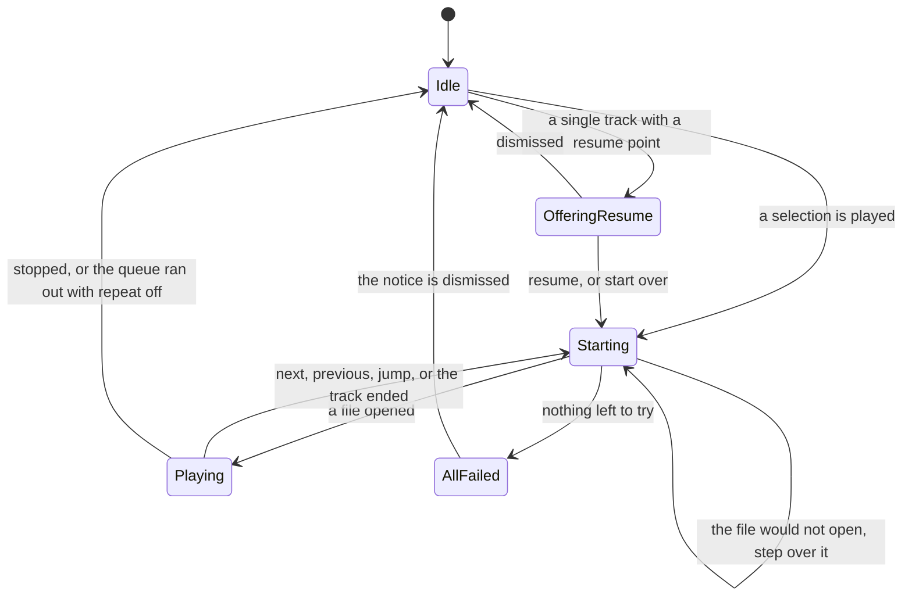
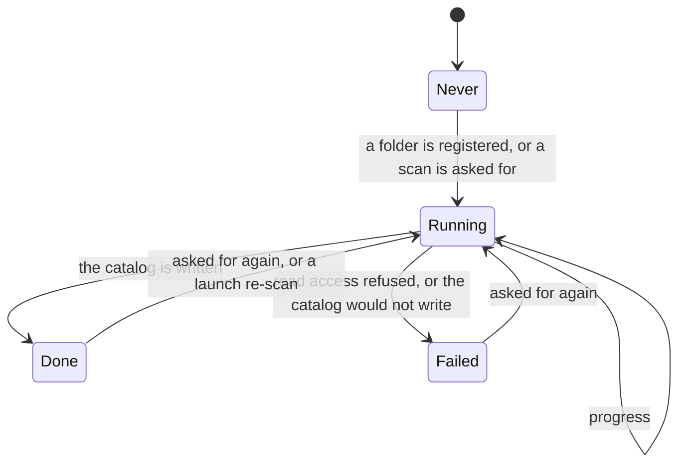
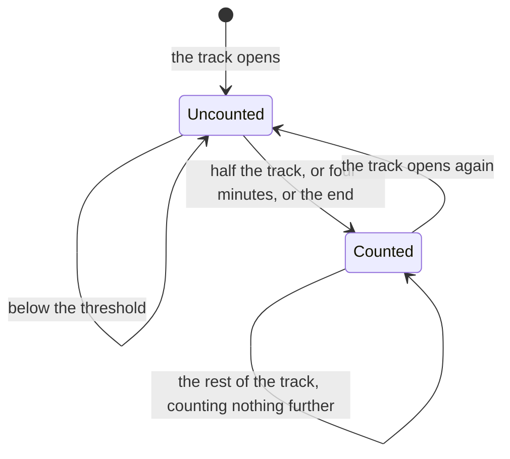

# Use Case Specification Document — Orpheus

## 1. Introduction

### 1.1 Purpose

The use cases that realise the requirements in the
[System Requirements Document](System%20Requirements%20Document.md). Each one
states its actors, its preconditions and postconditions, the requirements it
realises, its main flow, and **every** alternative flow.

An alternative flow is not an edge case to be handled if time allows. It is part
of the use case, and a use case whose alternatives are unimplemented is not
done.

### 1.2 Actors

| Actor | Description |
| --- | --- |
| **Owner** | The single human user, and the only actor with intent. Interacts with every use case below. |
| **Local filesystem** | The disks holding the library folders. Read for audio files and their tags; written within this application's own directory, to the one file the owner chose for an export or a backup (UC-39, UC-41, UC-42), read when the owner restores from one (UC-43), and into a music folder only for a `.lrc` beside a track whose words were looked up (UC-33) and for the tags of files whose autofill or tag edit the owner confirmed or, for an autofill of many songs, started (UC-34, UC-35, UC-37, UC-38, UC-44). |
| **Metadata service** | MusicBrainz, and the Cover Art Archive for covers. Asked only when the owner starts an autofill (UC-34, UC-44), at most once a second, and sent nothing that identifies the owner. |
| **Playback engine** | The libmpv-backed engine linked in process. Opens files, reports position and duration, and reports what it cannot decode. Never modifies a file. |
| **Host platform** | Windows, Linux or Android. Grants or refuses read access, provides the folder picker, and — on Android alone — provides the media session and the foreground service. |

### 1.3 Use case overview

```mermaid
graph LR
    subgraph Actors
        OWNER(("Owner"))
    end

    subgraph "Library sources (LB)"
        UC01[UC-01: Register a folder]
        UC02[UC-02: Add the music folder]
        UC03[UC-03: Grant read access]
        UC04[UC-04: Scan the library]
        UC05[UC-05: Review unreadable files]
        UC06[UC-06: Unregister a folder]
    end

    subgraph "Catalog (CT)"
        UC07[UC-07: Browse by artist]
        UC08[UC-08: Browse an artist's records]
        UC09[UC-09: Browse a record]
        UC10[UC-10: Browse every song]
        UC11[UC-11: Switch the layout]
        UC12[UC-12: Search the library]
        UC36[UC-36: Browse and play by genre]
    end

    subgraph "Playback (PL)"
        UC13[UC-13: Play a track]
        UC14[UC-14: Resume a track]
        UC15[UC-15: Play a record]
        UC16[UC-16: Play an artist]
        UC17[UC-17: Shuffle everything]
        UC18[UC-18: Pause, seek, volume]
        UC19[UC-19: Move through the queue]
        UC20[UC-20: Repeat]
        UC21[UC-21: See what is playing]
        UC22[UC-22: Open the full player]
        UC23[UC-23: Step over a bad file]
    end

    subgraph "Background (BG)"
        UC24[UC-24: Play in the background]
        UC25[UC-25: Control from outside]
    end

    subgraph "Statistics (ST)"
        UC26[UC-26: Count a play]
        UC27[UC-27: See what you listen to]
    end

    subgraph "Shell (UX)"
        UC28[UC-28: Navigate the shell]
        UC29[UC-29: Manage preferences]
    end

    subgraph "Lyrics (LY)"
        UC30[UC-30: Read the words]
        UC31[UC-31: Follow and jump]
        UC33[UC-33: Look the words up]
    end

    subgraph "Visualisation (VZ)"
        UC32[UC-32: See the music move]
    end

    subgraph "Autofill (AF)"
        UC34[UC-34: Autofill a record's tags]
        UC44[UC-44: Autofill many songs at once]
    end

    subgraph "Tag editing (TE)"
        UC35[UC-35: Edit a track's tags by hand]
        UC37[UC-37: Edit the tags of several tracks at once]
        UC38[UC-38: Select several songs and edit their tags]
    end

    subgraph "Playlists (PS)"
        UC39[UC-39: Keep playlists]
        UC40[UC-40: Play the auto playlists]
    end

    subgraph "Data export (DX)"
        UC41[UC-41: Export my data]
    end

    subgraph "Backup and restore (BK)"
        UC42[UC-42: Back up Orpheus]
        UC43[UC-43: Restore from a backup]
    end

    OWNER --> UC01
    OWNER --> UC07
    OWNER --> UC13
    OWNER --> UC24
    OWNER --> UC27
    OWNER --> UC28
    OWNER --> UC30
    OWNER --> UC32
    OWNER --> UC34
    OWNER --> UC35
    OWNER --> UC37
    OWNER --> UC38
    OWNER --> UC39
    OWNER --> UC40
    OWNER --> UC41
    OWNER --> UC42
    OWNER --> UC43
    OWNER --> UC44
```

---

## 2. Use case specifications

---

### UC-01: Register a music folder

| Field | Value |
| --- | --- |
| **ID** | UC-01 |
| **Name** | Register a music folder |
| **Actors** | Owner, Host platform, Local filesystem |
| **Description** | The owner adds a folder on disk as a source of audio files. Several may be registered. |
| **Preconditions** | None. This is reachable on a first launch. |
| **Postconditions** | The folder is recorded, persists between runs, and is offered for scanning. |
| **Requirements** | FR-LB-01, FR-LB-03, FR-LB-05, FR-LB-06 |

**Main Flow**

1. The application presents the folders screen. With nothing registered, it
   states that the library is empty and what to do about it.
2. The owner opens the platform's native folder picker and chooses a folder.
3. The application checks that the folder exists, can be read, and is not
   already registered.
4. The application records the folder and lists it among the registered ones.
5. A scan is started (UC-04).

**Alternative Flows**

| ID | Condition | Outcome |
| --- | --- | --- |
| AF-01 | The owner dismisses the picker | Nothing is registered and the screen is unchanged. |
| AF-02 | The folder does not exist or cannot be read | The application states which condition failed and registers nothing. |
| AF-03 | The folder is already registered | The application says so and registers nothing a second time. |
| AF-04 | The platform gates reading audio files and has not been asked | Read access is requested first (UC-03); the folder is registered regardless of the answer, because a folder registered without permission is a folder that will scan the moment permission is given. |

---

### UC-02: Add the conventional music folder

| Field | Value |
| --- | --- |
| **ID** | UC-02 |
| **Name** | Add the conventional music folder |
| **Actors** | Owner, Host platform |
| **Description** | The owner registers the folder the platform conventionally keeps music in, without navigating a picker to find it. |
| **Preconditions** | None. |
| **Postconditions** | As UC-01. |
| **Requirements** | FR-LB-02, FR-LB-03, FR-LB-05 |

**Main Flow**

1. The folders screen offers the platform's conventional music folder by name.
2. The owner presses it.
3. The application registers it exactly as UC-01 step 3 onward.

**Alternative Flows**

| ID | Condition | Outcome |
| --- | --- | --- |
| AF-01 | The platform names no such folder, or it does not exist | The offer is not shown. An offer that fails when pressed is worse than no offer. |
| AF-02 | It is already registered | The offer is not shown. |

> **It is offered, never assumed.** A first launch that had silently indexed the
> owner's music folder would have read files it was not pointed at, which is
> `BR-04` broken on the first run.

---

### UC-03: Grant read access to audio files

| Field | Value |
| --- | --- |
| **ID** | UC-03 |
| **Name** | Grant read access to audio files |
| **Actors** | Owner, Host platform |
| **Description** | On a platform that gates reading the owner's audio files, the application asks for that permission. |
| **Preconditions** | A folder has been registered, or is being registered. |
| **Postconditions** | The application either may read audio files, or knows it may not and why. |
| **Requirements** | FR-LB-07, FR-LB-08 |

**Main Flow**

1. The application requests the platform's audio-read permission.
2. The owner grants it.
3. Scanning proceeds.

**Alternative Flows**

| ID | Condition | Outcome |
| --- | --- | --- |
| AF-01 | The platform gates nothing — both desktops | The permission is granted immediately with no dialog, and the flow is indistinguishable from the main one. |
| AF-02 | The owner refuses | The application says the library cannot be read without it, and offers to ask again. Nothing is scanned. |
| AF-03 | The owner refuses in a way the system will not put again | The application says so and offers the system settings screen, which is the only way forward. |
| AF-04 | The platform release predates the per-media permission | The broader legacy permission is requested behind it, so that an older device is asked exactly once for the one permission it has. |

> **Asked once a folder is registered, never before.** A permission dialog on a
> launch where the owner has asked for nothing is a question about nothing.

---

### UC-04: Scan the library folders

| Field | Value |
| --- | --- |
| **ID** | UC-04 |
| **Name** | Scan the library folders |
| **Actors** | Owner, Local filesystem |
| **Description** | The registered folders are walked, every audio file's tags are read, cover art is extracted, and the catalog is rebuilt. |
| **Preconditions** | At least one folder is registered and readable. |
| **Postconditions** | The catalog reflects what is on disk, and is written. |
| **Requirements** | FR-LB-09 … FR-LB-18, FR-CT-02 |

**Main Flow**

1. The scan starts — on demand, after a folder is registered, or at launch when
   the preference says so.
2. It runs away from the interface. The library already on screen stays usable.
3. Every path under every registered folder is walked, and every file with a
   supported extension is considered.
4. A file unchanged since the last scan — same size, same modification time — is
   carried over rather than re-parsed.
5. Every other file's tags are read, and its embedded cover extracted and stored
   by content hash; a record with no embedded art but a cover image beside it
   uses that.
6. Progress is reported throughout, from a strip above the playback bar.
7. The album artist of every record is worked out across that record (`BR-08`).
8. The catalog is written atomically, and the library on screen is replaced by it.

**Alternative Flows**

| ID | Condition | Outcome |
| --- | --- | --- |
| AF-01 | A file's tags cannot be read | It is recorded as unreadable, named to the owner (UC-05), and the scan carries on. |
| AF-02 | A folder has disappeared since it was registered | It contributes nothing and the scan carries on; the folder stays registered, because a folder on a disconnected drive is not a folder the owner wanted removed. |
| AF-03 | Read access is refused | Nothing is scanned and the permission state is reported (UC-03). |
| AF-04 | No folder is registered | Nothing runs. |
| AF-05 | A scan is already running | The request is ignored rather than starting a second walk over the same disks. |
| AF-06 | The catalog cannot be written | The library is usable for this session and the failure is reported; the next scan tries again. |

---

### UC-05: Review the files a scan could not read

| Field | Value |
| --- | --- |
| **ID** | UC-05 |
| **Name** | Review the files a scan could not read |
| **Actors** | Owner |
| **Description** | The owner sees which files the last scan could not read. |
| **Preconditions** | A scan has run and found at least one unreadable file. |
| **Postconditions** | None. This use case only informs. |
| **Requirements** | FR-LB-13 |

**Main Flow**

1. The folders screen states how many files could not be read.
2. The owner opens the disclosure and sees them named.

**Alternative Flows**

| ID | Condition | Outcome |
| --- | --- | --- |
| AF-01 | Every file was read | Nothing is shown. A count of zero is noise. |

> **Named by their file names, and this is deliberate.** These are files with no
> readable tags — there is nothing else to call them, and this is one of the two
> documented exceptions to `BR-05`.

---

### UC-06: Unregister a music folder

| Field | Value |
| --- | --- |
| **ID** | UC-06 |
| **Name** | Unregister a music folder |
| **Actors** | Owner |
| **Description** | The owner removes a folder from the library sources. |
| **Preconditions** | At least one folder is registered. |
| **Postconditions** | The folder is no longer a source, and its files are no longer in the catalog. Nothing on disk has changed. |
| **Requirements** | FR-LB-04, FR-LB-05 |

**Main Flow**

1. The owner presses remove on a registered folder.
2. The application asks for confirmation, stating that nothing on disk will be
   deleted.
3. The owner confirms.
4. The folder is removed and the library is re-scanned, so the catalog no longer
   holds its files.

**Alternative Flows**

| ID | Condition | Outcome |
| --- | --- | --- |
| AF-01 | The owner cancels | Nothing changes. |
| AF-02 | Tracks from that folder are playing | Playback continues to the end of what is queued. The queue holds files, not catalog entries, and stopping the music because a folder was unregistered is not what the owner asked for. |
| AF-03 | It was the last folder | The library becomes empty and says so (FR-CT-10). |

> **The confirmation says what will *not* happen.** The fear this dialog exists
> to answer is "will this delete my music", and the answer is the sentence.

---

### UC-07: Browse the library by artist

| Field | Value |
| --- | --- |
| **ID** | UC-07 |
| **Name** | Browse the library by artist |
| **Actors** | Owner |
| **Description** | The owner sees every artist in the library. |
| **Preconditions** | The catalog holds at least one entry. |
| **Postconditions** | None. |
| **Requirements** | FR-CT-01, FR-CT-02, FR-CT-05, FR-CT-06 |

**Main Flow**

1. The owner selects the artists view in the music area.
2. The application derives the artists from the catalog by album artist
   (`BR-08`) and lists them, each with a representative sleeve.
3. The owner selects one and drills into it (UC-08).

**Alternative Flows**

| ID | Condition | Outcome |
| --- | --- | --- |
| AF-01 | The library is empty | The empty state says so, and points at the folders screen. |
| AF-02 | An artist's records carry no album-artist tag anywhere | They are grouped under the performer most of the record's tracks name (`BR-09`), and appear as one artist rather than one per guest. |
| AF-03 | A track names no artist at all | It is grouped under the single localized word for an unnamed artist, alongside every other such track. |

---

### UC-08: Browse an artist's records

| Field | Value |
| --- | --- |
| **ID** | UC-08 |
| **Name** | Browse an artist's records |
| **Actors** | Owner |
| **Description** | The owner sees the records credited to one artist. |
| **Preconditions** | An artist has been selected. |
| **Postconditions** | None. |
| **Requirements** | FR-CT-01, FR-CT-03, FR-CT-04 |

**Main Flow**

1. The application lists the records belonging to that artist, with their
   sleeves and their years.
2. A breadcrumb states where the owner is and offers the way back.
3. The owner selects a record and drills into it (UC-09).

**Alternative Flows**

| ID | Condition | Outcome |
| --- | --- | --- |
| AF-01 | The artist has one record | It is still listed rather than skipped past. Being moved somewhere the owner did not ask to go is worse than one extra press. |
| AF-02 | A record names no album | It is grouped under the single localized word for an unnamed record. |

---

### UC-09: Browse a record's tracks

| Field | Value |
| --- | --- |
| **ID** | UC-09 |
| **Name** | Browse a record's tracks |
| **Actors** | Owner |
| **Description** | The owner sees the tracks on one record, in order. |
| **Preconditions** | A record has been selected. |
| **Postconditions** | None. |
| **Requirements** | FR-CT-01, FR-CT-03, FR-CT-04, FR-CT-06, FR-CT-11 |

**Main Flow**

1. The application lists the record's tracks in track order, across discs where
   the tags name them, showing each track's title, performer and length.
2. The record's sleeve, its artist and its year head the listing, with actions to
   play it and to play it shuffled.
3. The owner selects a track to play it (UC-13).

**Alternative Flows**

| ID | Condition | Outcome |
| --- | --- | --- |
| AF-01 | Tracks carry no track numbers | They are ordered by title, and where there is no title either, by file name — which is deterministic, which is what matters. |
| AF-02 | A track carries no title | The single localized word for an untitled track stands in for it (`BR-06`). |
| AF-03 | The record has no cover | A placeholder drawn from the theme stands in. No cover is ever fetched (`BR-03`). |

---

### UC-10: Browse every song

| Field | Value |
| --- | --- |
| **ID** | UC-10 |
| **Name** | Browse every song |
| **Actors** | Owner |
| **Description** | The owner sees every track in the library as one list. |
| **Preconditions** | The catalog holds at least one entry. |
| **Postconditions** | None. |
| **Requirements** | FR-CT-01, FR-CT-05, FR-CT-06 |

**Main Flow**

1. The owner selects the songs view.
2. Every track in the library is listed, named by its tags.
3. The owner selects one to play it (UC-13).

**Alternative Flows**

| ID | Condition | Outcome |
| --- | --- | --- |
| AF-01 | The library is empty | The empty state says so. |

---

### UC-11: Switch between rows and sleeves

| Field | Value |
| --- | --- |
| **ID** | UC-11 |
| **Name** | Switch between rows and sleeves |
| **Actors** | Owner |
| **Description** | The owner chooses whether a listing is rows or a grid of sleeves. |
| **Preconditions** | A listing is on screen. |
| **Postconditions** | The choice is remembered. |
| **Requirements** | FR-CT-05 |

**Main Flow**

1. The owner presses the layout control.
2. The listing is redrawn in the other arrangement.
3. The choice is written and applies to later sessions.

**Alternative Flows**

| ID | Condition | Outcome |
| --- | --- | --- |
| AF-01 | The choice cannot be written | The layout still changes, and the failure is reported as any unwritten preference is (`BR-25`). |

---

### UC-12: Search the library

| Field | Value |
| --- | --- |
| **ID** | UC-12 |
| **Name** | Search the library |
| **Actors** | Owner |
| **Description** | The owner finds tracks by typing part of a title, an artist, a record or a genre, and can narrow the search to one of those. |
| **Preconditions** | The catalog holds at least one entry. |
| **Postconditions** | None. |
| **Requirements** | FR-CT-07, FR-CT-08, FR-CT-09 |

**Main Flow**

1. The owner types into the search field — present in the bar on a desktop, and
   behind a button on a phone, where a field beside a title would be too small
   to read.
2. Under the results heading a selector offers *All*, *Songs*, *Artists*,
   *Albums* and *Genres*; *All* is chosen at first (`FR-CT-07`).
3. The application matches the term against what the choice names: the title
   for *Songs*; the artist and the album artist for *Artists*; the record for
   *Albums*; any of a track's genres for *Genres*; and all of them for *All*,
   where a genre match ranks after a record match.
4. Results are ranked so that a match at the start of a name outranks one within
   it (`FR-CT-08`), and are listed as tracks, whichever choice was made. A track
   matches a choice only through the fields that choice names: under *Songs*, a
   track tagged *Rock* is not a match for *Rock* unless its title is.
5. The owner selects a result and plays it, or drills into it.
6. The owner may change the choice at any time; the results are matched again,
   and the choice is kept across searches, clearing and the destinations of the
   shell for as long as the application runs, and is *All* again at the next
   launch.

**Alternative Flows**

| ID | Condition | Outcome |
| --- | --- | --- |
| AF-01 | The term is too short to be worth matching | Nothing is searched and the listing behind stays as it was. |
| AF-02 | Nothing matches | The application says so, quoting what was typed. |
| AF-03 | The owner clears the term | The results are dismissed and the listing behind returns, at the level they left it. |
| AF-04 | The system back gesture is used while results are showing | It clears the search first, before it goes back a level, because the results are what is covering the screen. |
| AF-05 | A narrowed search matches nothing | The application says so, quoting what was typed, and the selector stays where it was so the owner can widen the search to *All*. |

---

### UC-13: Play a track

| Field | Value |
| --- | --- |
| **ID** | UC-13 |
| **Name** | Play a track |
| **Actors** | Owner, Playback engine, Local filesystem |
| **Description** | The owner plays one track on its own. |
| **Preconditions** | A track is on screen. |
| **Postconditions** | A queue of one exists and the engine is playing it. |
| **Requirements** | FR-PL-01, FR-PL-11, FR-PL-16, FR-PL-19 |

**Main Flow**

1. The owner selects a track.
2. The application checks whether a resume point is recorded for it.
3. With none, a queue of that single track is built and the engine opens it from
   the start at the remembered volume.
4. The playback bar shows what is playing; the full player opens itself if the
   preference says so.

**Alternative Flows**

| ID | Condition | Outcome |
| --- | --- | --- |
| AF-01 | A resume point is recorded | The owner is asked before anything opens (UC-14). |
| AF-02 | The file is no longer on disk | UC-23. |
| AF-03 | The engine cannot decode it | UC-23. |
| AF-04 | Something is already playing | It is replaced. Selecting a track is an instruction, not a suggestion. |

---

### UC-14: Resume a track where it stopped

| Field | Value |
| --- | --- |
| **ID** | UC-14 |
| **Name** | Resume a track where it stopped |
| **Actors** | Owner, Playback engine |
| **Description** | A track with a recorded position is offered at that position before it opens. |
| **Preconditions** | The owner played a single track that carries a resume point. |
| **Postconditions** | Playback started either at the recorded position or at the beginning; either way no question remains. |
| **Requirements** | FR-PL-10, FR-PL-11, FR-PL-12, FR-PL-13 |

**Main Flow**

1. The application states the recorded position and offers to resume there or to
   start over. Nothing has opened yet.
2. The owner chooses to resume.
3. The engine opens the file and seeks to the recorded position.

**Alternative Flows**

| ID | Condition | Outcome |
| --- | --- | --- |
| AF-01 | The owner chooses to start over | The recorded position is forgotten first, then the file opens from the beginning — so abandoning it again records a new point rather than leaving the old one. |
| AF-02 | The owner dismisses the offer | Nothing opens and nothing is forgotten. The offer was a question, and declining to answer it is an answer. |
| AF-03 | A record or an artist was played instead of a single track | The question is never asked (`BR-15`, FR-PL-12). |
| AF-04 | The recorded position is at or past the end | It is treated as no position at all. |

> **Positions are written while playing, on pause, and on seek.** Periodically
> while running, because a session that ends unexpectedly should still be
> resumable; immediately on the other two, because both are the owner saying
> where they are.

---

### UC-15: Play a record

| Field | Value |
| --- | --- |
| **ID** | UC-15 |
| **Name** | Play a record |
| **Actors** | Owner, Playback engine |
| **Description** | The owner plays a whole record, in order or shuffled. |
| **Preconditions** | A record, or a track on one, is on screen. |
| **Postconditions** | A queue of that record's tracks exists and is playing. |
| **Requirements** | FR-PL-02, FR-PL-12, FR-PL-16 |

**Main Flow**

1. The owner presses play on a record.
2. The application gathers every track on it from the catalog, in track order.
3. The queue starts at the track the owner started from — a record entered at
   track seven begins at seven — or at the top when the record itself was
   pressed.
4. The engine opens the first track of the queue.

**Alternative Flows**

| ID | Condition | Outcome |
| --- | --- | --- |
| AF-01 | The owner asked for it shuffled | The same tracks are queued in an order nobody chose, and playback begins at the top of that order — starting a shuffle at the track that was clicked would make the first track the one predictable thing about it. |
| AF-02 | The library cannot be read, so no record can be gathered | The application reports that nothing in the selection could be played. It does not silently fall back to the single track, which would turn "play the record" into "play the track" without saying so. |
| AF-03 | Some of the record's files are missing | They are stepped over as the queue reaches them (UC-23). |
| AF-04 | The tracks name no record at all | The untitled group under that album artist is queued whole — it is the group the Albums list showed and drilled into, and a play button on a group of forty that played one of them would be answering a different question from the one it was asked. |
| AF-05 | The file is one the library does not hold | It plays alone. There is no record around a file the library has never seen, and it must not be mistaken for a member of the untitled group. |

---

### UC-16: Play everything by an artist

| Field | Value |
| --- | --- |
| **ID** | UC-16 |
| **Name** | Play everything by an artist |
| **Actors** | Owner, Playback engine |
| **Description** | The owner plays an artist's whole catalogue, in order or shuffled. |
| **Preconditions** | An artist, or a track of theirs, is on screen. |
| **Postconditions** | A queue of that artist's tracks exists and is playing. |
| **Requirements** | FR-PL-03, FR-PL-12 |

**Main Flow**

1. The owner presses play on an artist.
2. The application gathers every track whose record is credited to that artist —
   by album artist, so a guest appearance stays on the host's record.
3. The queue plays through, record by record.

**Alternative Flows**

| ID | Condition | Outcome |
| --- | --- | --- |
| AF-01 | Shuffled | As UC-15 AF-01. |
| AF-02 | The library cannot be read | As UC-15 AF-02. |

> **The queue is labelled by the album artist, not the performer.** Labelling a
> queue of an artist's whole catalogue after one track's guest would name the
> wrong person on the bar for an hour.

---

### UC-17: Shuffle the whole library

| Field | Value |
| --- | --- |
| **ID** | UC-17 |
| **Name** | Shuffle the whole library |
| **Actors** | Owner, Playback engine |
| **Description** | The owner plays everything, in an order nobody chose. |
| **Preconditions** | The catalog holds at least one entry. |
| **Postconditions** | A queue of the whole library exists, shuffled, and is playing. |
| **Requirements** | FR-PL-04 |

**Main Flow**

1. The owner presses shuffle everything.
2. Every track the *library* holds is gathered — not the view currently on
   screen — and shuffled over a copy (`BR-18`).
3. Playback begins at the top of that order.

**Alternative Flows**

| ID | Condition | Outcome |
| --- | --- | --- |
| AF-01 | The library is empty | Nothing is queued and nothing is reported as failed, because nothing was attempted. |
| AF-02 | The library cannot be read | The application reports that nothing could be played. |

> **Every track, not the view.** "Shuffle everything" said while standing inside
> one artist would otherwise mean something different from the same words said
> in the songs list, and neither reading is written anywhere the owner could
> check.

---

### UC-18: Pause, seek and set the volume

| Field | Value |
| --- | --- |
| **ID** | UC-18 |
| **Name** | Pause, seek and set the volume |
| **Actors** | Owner, Playback engine |
| **Description** | The owner controls playback of the track running. |
| **Preconditions** | A track is open. |
| **Postconditions** | Playback state reflects what was asked; the volume and the position are recorded. |
| **Requirements** | FR-PL-06, FR-PL-10 |

**Main Flow**

1. The owner pauses; the engine stops and the position is written immediately.
2. The owner resumes; the engine runs on from where it was.
3. The owner drags the position slider; playback moves there and the position is
   written immediately.
4. The owner changes the volume; the engine's output level changes and the value
   is written.

**Alternative Flows**

| ID | Condition | Outcome |
| --- | --- | --- |
| AF-01 | A seek is asked for beyond the track's length | It is bounded to the track's length. The slider hands over a fraction of a duration that may since have changed, and seeking past the end of whatever is playing now is never what was meant. |
| AF-02 | A seek is asked for below zero | It is bounded to zero. |
| AF-03 | Nothing is open | The controls do nothing rather than starting something. |

---

### UC-19: Move through the queue

| Field | Value |
| --- | --- |
| **ID** | UC-19 |
| **Name** | Move through the queue |
| **Actors** | Owner, Playback engine |
| **Description** | The owner moves to the next or previous track, or jumps to any entry in the queue. |
| **Preconditions** | A queue exists. |
| **Postconditions** | The chosen track is open. |
| **Requirements** | FR-PL-05, FR-PL-07, FR-PL-08, FR-PL-20 |

**Main Flow**

1. The owner presses next; the queue advances and the engine opens the next
   track.
2. The owner presses previous more than five seconds into a track; it restarts.
3. The owner presses previous within five seconds; the queue steps back.
4. The owner opens the queue, sees it in play order, and taps an entry; that
   track opens.

**Alternative Flows**

| ID | Condition | Outcome |
| --- | --- | --- |
| AF-01 | Next is pressed on the last track with repeat off | Nothing happens. |
| AF-02 | Next is pressed on the last track with repeat on | The queue returns to its first track (UC-20). |
| AF-03 | Previous is pressed on the first track | The track restarts, because there is nowhere to step back to. |
| AF-04 | A queue entry outside the queue's range is asked for | It is ignored rather than clamped. The queue on screen and the queue in hand can differ by a frame, and jumping to whichever track is nearest is not what was pressed. |
| AF-05 | Two opens overlap — next pressed twice, or a track ending as next is pressed | Only the newest one takes effect; the older abandons itself, so the queue advances once (FR-PL-20). |

---

### UC-20: Repeat a queue or a track

| Field | Value |
| --- | --- |
| **ID** | UC-20 |
| **Name** | Repeat a queue or a track |
| **Actors** | Owner, Playback engine |
| **Description** | The owner chooses what happens when the queue runs out. |
| **Preconditions** | None. |
| **Postconditions** | The mode is applied and remembered. |
| **Requirements** | FR-PL-09, FR-PL-07 |

**Main Flow**

1. The owner presses repeat; the mode cycles off → all → one.
2. The mode is written and applies to later sessions.
3. At the end of the last track: with *all*, the queue starts again from its
   first track; with *one*, the track playing opens again; with *off*, playback
   stops and the queue is cleared.

**Alternative Flows**

| ID | Condition | Outcome |
| --- | --- | --- |
| AF-01 | Repeat *all* with an empty queue | Nothing repeats. |
| AF-02 | Repeat *one* is set | Each time round is a new playthrough and counts a play of its own (UC-26, `BR-21`). |

---

### UC-21: See what is playing

| Field | Value |
| --- | --- |
| **ID** | UC-21 |
| **Name** | See what is playing |
| **Actors** | Owner |
| **Description** | The owner sees what is playing from anywhere in the application. |
| **Preconditions** | None. |
| **Postconditions** | None. |
| **Requirements** | FR-PL-16, FR-PL-19, FR-CT-06 |

**Main Flow**

1. A bar across the bottom shows the track's sleeve, its title and its artist,
   the transport, and the position — from every area of the application.
2. The bar names the track by its tags (`BR-05`) and the queue by what it is.

**Alternative Flows**

| ID | Condition | Outcome |
| --- | --- | --- |
| AF-01 | Nothing is playing | The bar takes no height. |
| AF-02 | A track was skipped | The bar names the file that was skipped, and the notice is dismissible (UC-23). |
| AF-03 | The window is narrow | The transport reduces to what fits, and the sleeve and title stay. |

---

### UC-22: Open the full player

| Field | Value |
| --- | --- |
| **ID** | UC-22 |
| **Name** | Open the full player |
| **Actors** | Owner |
| **Description** | The owner opens the full-window player. |
| **Preconditions** | Something is playing or queued. |
| **Postconditions** | None. |
| **Requirements** | FR-PL-17, FR-PL-18 |

**Main Flow**

1. The owner presses the playback bar, or a track starts and the preference says
   the player opens itself.
2. The player shows the record's sleeve as large as the window allows, the
   track's names, the full transport, the position, and the queue.
3. The owner closes it and returns to where they were.

**Alternative Flows**

| ID | Condition | Outcome |
| --- | --- | --- |
| AF-01 | The player is already open when another track starts | It is not opened a second time on top of itself. |
| AF-02 | The preference is off | A track starting leaves the owner where they were. |
| AF-03 | Reduced motion is asked for by the system | The moving elements stop moving, and the screen is otherwise unchanged. |

---

### UC-23: Step over a file that will not play

| Field | Value |
| --- | --- |
| **ID** | UC-23 |
| **Name** | Step over a file that will not play |
| **Actors** | Owner, Playback engine, Local filesystem |
| **Description** | A queued file that is missing or cannot be decoded is named, stepped over, and the queue carries on. |
| **Preconditions** | A queue is playing. |
| **Postconditions** | Either a later track is playing, or the application has said that nothing could be played. |
| **Requirements** | FR-PL-14, FR-PL-15 |

**Main Flow**

1. The queue reaches a file that is no longer on disk, or that the engine
   reports it cannot decode.
2. The application records it as skipped and names it to the owner.
3. The queue moves to the next track and opens it.

**Alternative Flows**

| ID | Condition | Outcome |
| --- | --- | --- |
| AF-01 | Every remaining track also fails | The queue is cleared and the application states that nothing in the selection could be played. |
| AF-02 | The owner dismisses the notice | It is cleared and does not return for the same file. |
| AF-03 | The last skipped file is followed by a successful one | The notice still names the file that failed, even though the queue has moved past it. |

> **A missing file and an undecodable one are one movement.** Why a file would
> not open is the same answer for the owner either way — go and look at that
> file — so the application names it and says no more.

---

### UC-24: Keep playing in the background

| Field | Value |
| --- | --- |
| **ID** | UC-24 |
| **Name** | Keep playing in the background |
| **Actors** | Owner, Host platform, Playback engine |
| **Description** | On Android, playback continues once the application is no longer on screen. |
| **Preconditions** | The host is Android and something is playing. |
| **Postconditions** | Playback continues, and a notification says what is playing. |
| **Requirements** | FR-BG-01, FR-BG-02, FR-BG-05, FR-BG-09, FR-BG-10 |

**Main Flow**

1. The platform's media session is started before the first frame, because the
   service it runs on must be bound to the process before anything can publish
   to it.
2. The first time there is something to show, the application asks to be allowed
   to post a notification.
3. As playback runs, the session is told what is playing — the title, the
   artist, the record, the sleeve, the position, and which transport buttons
   should be live.
4. The owner switches away. The foreground service keeps the process alive and
   the music keeps playing.
5. The notification and the lock screen show what is playing.

**Alternative Flows**

| ID | Condition | Outcome |
| --- | --- | --- |
| AF-01 | The host is Windows or Linux | The same seam is bound to a session that shows nothing. Nothing above it behaves differently, and nothing above it contains a platform check (FR-BG-09). |
| AF-02 | The owner refuses the notification permission | Playback and the service are unaffected; only the notification is not shown. The owner is not asked again. |
| AF-03 | The media session cannot be started at all | It is reported, and the application opens and plays as it did before there was one (FR-BG-10). |
| AF-04 | Playback stops, or the queue is cleared | The session is taken down. |
| AF-05 | The owner is being asked where to resume from, or nothing could be played | Nothing is published — none of those is a track playing. |
| AF-06 | The track has no sleeve | The notification shows the application's own icon rather than an empty square. |

> **The notification is the background playback.** A foreground service is the
> only mechanism Android offers for a process that keeps making noise off
> screen, and posting a notification is what the system requires of one. They
> are one thing, not a feature and its decoration.

---

### UC-25: Control playback from outside the application

| Field | Value |
| --- | --- |
| **ID** | UC-25 |
| **Name** | Control playback from outside the application |
| **Actors** | Owner, Host platform, Playback engine |
| **Description** | The owner controls playback from the notification, the lock screen or a headset — and the system does too, when it takes the audio away. |
| **Preconditions** | A media session is running and something is queued. |
| **Postconditions** | The player did what was asked. |
| **Requirements** | FR-BG-03, FR-BG-04, FR-BG-06, FR-BG-07, FR-BG-08 |

**Main Flow**

1. The owner presses play, pause, next, previous or stop on the notification,
   the lock screen, or a connected headset.
2. The command reaches the player, which does exactly what the equivalent
   control inside the application does.
3. The session is told the new state.

**Alternative Flows**

| ID | Condition | Outcome |
| --- | --- | --- |
| AF-01 | A phone call arrives, or another application takes the output | The player pauses. |
| AF-02 | The system hands the output back after a temporary interruption | Playback resumes. |
| AF-03 | The interruption was permanent | Playback stays paused. Starting up again would be this application talking over whatever took the output. |
| AF-04 | Headphones are pulled out | Playback pauses, and never resumes by itself — that is precisely what the owner was avoiding. |
| AF-05 | A pause arrives when playback is already paused | Nothing happens. An unguarded toggle would answer an incoming call by starting the music into the middle of it. |
| AF-06 | A play arrives when playback is already running | Nothing happens. |
| AF-07 | The session is scrubbed | Playback moves there, bounded exactly as UC-18 bounds it. |

> **A pressed button and a phone call are the same ask.** Both reach the player
> as "pause", through one stream, and the player never learns which was which —
> which is what keeps audio focus from becoming a second set of rules.

---

### UC-26: Count a track as played

| Field | Value |
| --- | --- |
| **ID** | UC-26 |
| **Name** | Count a track as played |
| **Actors** | Owner, Playback engine |
| **Description** | The application decides that a track has been listened to, and records it. |
| **Preconditions** | A track is open and its length is known. |
| **Postconditions** | The play history holds one more play of that file, with the date it was counted. |
| **Requirements** | FR-ST-01 … FR-ST-07, FR-ST-16 … FR-ST-19 |

**Main Flow**

1. As the engine reports position, the application applies the threshold: half
   the track, or four minutes, whichever comes first (`BR-19`).
2. On the first report past it, the track is marked counted for this playthrough
   and a play is recorded.
3. The record is written without playback waiting for it.

**Alternative Flows**

| ID | Condition | Outcome |
| --- | --- | --- |
| AF-01 | The track is abandoned before the threshold | Nothing is counted. |
| AF-02 | Playback continues past the threshold | Nothing further is counted; the flag prevents every later report from counting again. |
| AF-03 | The engine has not reported a length | Nothing is counted yet; the next status carries the real value (`BR-20`). |
| AF-04 | The track is short enough that no report landed past half way | Reaching its end counts it, so that a very short track is not the one kind that never counts. |
| AF-05 | The same track is opened again — repeat *one*, or played again from the start | The flag is cleared when the track *opens*, so the new playthrough counts again (`BR-21`). |
| AF-06 | The history cannot be written | It is logged and dropped. Playback is unaffected (`BR-22`). |
| AF-07 | Two plays are recorded at nearly the same moment | Writes are serialized, so neither is lost (FR-ST-05). |
| AF-08 | The play history is of the version before dates were kept | Every track, its count and its last play are kept and it is written as version 2 by this play; the first time it is read, the old document is also copied once to `play-history.json.v1` (FR-ST-17). |
| AF-09 | The stored history cannot be understood — it is not UTF-8 or not JSON, is not a play history, or was written by a version this one does not read | It is kept aside as `play-history.json.bad-<time>` and never overwritten, and the history starts empty (FR-ST-18). |
| AF-10 | The stored history is readable but holds a row that is not a play, or a date that is not one | That row or date is stepped over, and the document is first copied aside as `play-history.json.bad-<time>` so what is left out can be recovered by hand (FR-ST-18). |
| AF-11 | The stored history can be neither read, nor set aside or copied aside, nor — for one of the version before dates were kept — copied once to `play-history.json.v1` | Nothing is recorded for the rest of the run, nothing is written and the document is never replaced; playback continues, the failure is logged, and the next start tries again (FR-ST-19). |
| AF-12 | A track has plays older than 90 days | Their dates are dropped when the history is read and written; the count and the last play stay (FR-ST-16). |

---

### UC-27: See what you listen to

| Field | Value |
| --- | --- |
| **ID** | UC-27 |
| **Name** | See what you listen to |
| **Actors** | Owner |
| **Description** | The owner sees totals and four rankings drawn from their own listening. |
| **Preconditions** | None. |
| **Postconditions** | None. |
| **Requirements** | FR-ST-08 … FR-ST-15, FR-ST-20, FR-UX-03 |

**Main Flow**

1. The owner opens the statistics from the shell.
2. The application reads the play history and the catalog together, from one
   instant, and derives the rankings (`BR-23`).
3. The screen shows the total number of plays and the number of distinct tracks
   they came from.
4. Under them it shows four rankings — most played tracks, artists, records and
   genres — most played first, ties ordered by name so the list is stable. A
   track with several genres counts toward each of them, so a genre's share of
   the plays is taken of all plays and the shares may add up to more than 100%
   (`FR-ST-09`).
5. The owner presses *read again* to read it afresh.

**Alternative Flows**

| ID | Condition | Outcome |
| --- | --- | --- |
| AF-01 | Nothing has been played | The screen states what makes a track count, rather than only that there is nothing (FR-ST-15). |
| AF-02 | A ranking has no rows | Its heading is drawn with a line saying it is empty. Dropping the heading would say the application forgot about genres. |
| AF-03 | A played track carries no artist, record or genre tag | It counts in the totals, ranks in none of those three, and a note explains the difference (`BR-24`). A track has no genre only when it has none at all. |
| AF-04 | A played track carries no title | It is named by its file, which is the second documented exception to `BR-05`. |
| AF-05 | A played file is no longer in the catalog | It still counts and is named by its file; there are no tags left to rank it by. |
| AF-06 | The library cannot be read | The totals and the track ranking are still shown, named by file. Statistics do not fail because the library did. |
| AF-07 | A play lands while the screen is open | The screen does not move. A chart reordering itself under the reader is harder to read than one a minute old, and *read again* is one press away. |
| AF-08 | The history was migrated from the version before dates were kept | The totals and the rankings are the numbers they were: only counts and last plays are read (FR-ST-20). |

> **All time, and no windows.** "This month" is a control, a parameter and a
> second set of numbers to explain, and none of it is worth adding before anyone
> has read the first one.

---

### UC-28: Navigate the application shell

| Field | Value |
| --- | --- |
| **ID** | UC-28 |
| **Name** | Navigate the application shell |
| **Actors** | Owner |
| **Description** | The owner moves between the five areas of the application. |
| **Preconditions** | None. |
| **Postconditions** | None. |
| **Requirements** | FR-UX-01, FR-UX-02, FR-UX-03, FR-UX-07 |

**Main Flow**

1. The shell presents five destinations — music, genres, playlists, queue, folders.
2. Where the window is wide enough they are a rail down the side; where it is
   not they are a bar across the bottom.
3. The owner selects one and the content area changes.
4. The playback bar and the scan strip stay put, below every area.

**Alternative Flows**

| ID | Condition | Outcome |
| --- | --- | --- |
| AF-01 | The window is resized across the breakpoint | The arrangement changes with it, without losing where the owner was. |
| AF-02 | The system back gesture is used with somewhere to go back to | It goes back a level in the music area or in the genres area, closes an open playlist, or clears a search, rather than closing the application. |
| AF-03 | The system back gesture is used with nowhere to go | It does whatever the platform does with it. |

> **Five destinations, deliberately.** This application does one thing, and a
> navigation panel listing six ways into it would be six ways of asking the
> owner where they want to be before they have heard anything. Genres earned
> its place beside Music because the owner listens by mood as often as by
> artist, and Playlists earned its place beside Genres because a playlist is the
> owner's own order, which neither of them can give. The statistics screen is
> reached from the bar rather than becoming a sixth (FR-UX-03).

---

### UC-29: Manage preferences

| Field | Value |
| --- | --- |
| **ID** | UC-29 |
| **Name** | Manage preferences |
| **Actors** | Owner |
| **Description** | The owner changes the theme, the language, and how the application behaves. |
| **Preconditions** | None. |
| **Postconditions** | The choices apply and are remembered. |
| **Requirements** | FR-UX-04, FR-UX-05, FR-UX-06, FR-PL-18, FR-LB-18, FR-PS-21, FR-DX-01, FR-BK-01, FR-BK-07 |

**Main Flow**

1. The owner opens the preferences.
2. They choose light, dark or the system's setting; English, Brazilian
   Portuguese or the system's language; whether the full player opens itself
   when a track starts; whether the library is re-scanned at launch; and
   whether the auto playlists are shown (*Show auto playlists*, on by default;
   UC-40).
3. Each choice applies immediately and is written behind.
4. Under *Your data*, *Export my data (JSON)…* saves the owner's data to a file they choose (UC-41), *Back up Orpheus
   (ZIP)…* saves a backup to one (UC-42), and *Restore from a backup…* brings a backup or an export back (UC-43);
   *About these exports* compares the first two. They are actions, not choices: nothing about them is remembered.

**Alternative Flows**

| ID | Condition | Outcome |
| --- | --- | --- |
| AF-01 | A choice cannot be written | It still applies, and the screen says it will not persist. A preference the owner will have to set again next launch is one they are owed the reason for (`BR-25`). |
| AF-02 | The system language is not one the application ships | It falls back to English, and choosing a language explicitly still works. |
| AF-03 | The theme is set to follow the system and the system changes | The application follows it without being reopened. |

---

### UC-30: Read the words of what is playing

| Field | Value |
| --- | --- |
| **ID** | UC-30 |
| **Name** | Read the words of what is playing |
| **Actors** | Owner, Local filesystem |
| **Description** | The owner asks for the words of the track playing, and the application shows whatever the machine holds for it. |
| **Preconditions** | Something is playing, and the full player is open. |
| **Postconditions** | None. Nothing about the track has changed. |
| **Requirements** | FR-LY-01, FR-LY-02, FR-LY-03, FR-LY-07, FR-LY-08, FR-LY-09, FR-LY-10, FR-LY-12 |

**Main Flow**

1. The owner presses the lyrics control on the full player.
2. The application looks for the words of the track playing: first a `.lrc`
   beside it and named after it, then its `SYLT` frame, then its lyrics text
   tag. The first of those that holds words is the answer (`BR-30`).
3. The words take the place of the record's sleeve, which is the region of the
   screen large enough to read from.
4. The line being sung is distinguished, and the sheet follows the music
   (UC-31).
5. The owner presses the control again and the sleeve returns.

**Alternative Flows**

| ID | Condition | Outcome |
| --- | --- | --- |
| AF-01 | This machine holds no words for the track | The words are looked up (UC-33). Where that finds none, or the owner has turned the lookup off, the panel says there are none and says where words come from. It is not drawn as a failure. |
| AF-02 | The words carry no times | They are shown as a sheet to read, stated to carry no times, and do not follow the music. No times are invented for them. |
| AF-03 | Both a sidecar and the file's own tags hold words | The sidecar is shown — it is the copy the owner can edit without a tag editor. |
| AF-04 | The tag holds both a timed frame and a text one | The timed frame is shown. |
| AF-05 | The `SYLT` frame counts its times in MPEG frames, or is compressed or encrypted | It is declined, and the text tag answers instead. Nothing is approximated. |
| AF-06 | The sidecar or the file cannot be read | The words are lost and nothing else is: playback is not interrupted, and the panel shows the no-words state. |
| AF-07 | The queue moves to another track while the words are showing | The words of the new track are looked for, and the panel is showing that track's own state. |
| AF-08 | The owner closes the player and opens it again | It is still showing the words: reading along is a way of listening to a record, not to one track. |

---

### UC-31: Follow the words and jump to a line

| Field | Value |
| --- | --- |
| **ID** | UC-31 |
| **Name** | Follow the words and jump to a line |
| **Actors** | Owner, Playback engine |
| **Description** | Timed words follow the music, and a line can be used to move playback to where it is sung. |
| **Preconditions** | The words of the track playing are showing and carry times. |
| **Postconditions** | Playback is where the owner put it, or where it had got to on its own. |
| **Requirements** | FR-LY-04, FR-LY-05, FR-LY-06, FR-LY-11 |

**Main Flow**

1. The engine reports the position within the track.
2. The application distinguishes the line whose time is the latest one at or
   before that position.
3. The sheet scrolls that line into view without being asked.
4. The owner presses a line, and playback moves to the time that line carries.

**Alternative Flows**

| ID | Condition | Outcome |
| --- | --- | --- |
| AF-01 | Playback has not reached the first line — an intro, a count-in | No line is distinguished. Nothing pretends to be the line being sung. |
| AF-02 | The sheet times a gap between verses | No line is distinguished through it, rather than the last line of the verse staying lit through the solo. |
| AF-03 | The owner scrolls the words themselves | Following stops long enough to read ahead, then resumes on its own. |
| AF-04 | The words carry no times | No line is distinguished and pressing one does nothing: an untimed line is not a place in the track. |
| AF-05 | The player is opened part-way through a track | The line being sung is already in view — it is jumped to rather than scrolled to from the top. |
| AF-06 | The system asks for reduced motion | The scrolling is not animated, and the screen is otherwise unchanged. |

---

### UC-33: Look the words up for a track that has none

| Field | Value |
| --- | --- |
| **ID** | UC-33 |
| **Name** | Look the words up for a track that has none |
| **Actors** | Owner, Lyrics service, Local filesystem |
| **Description** | For a track this machine holds no words for, the application asks a lyrics service for them and saves what it gets beside the track. |
| **Preconditions** | The words of the track playing have been looked for locally and none were found (UC-30, step 2), and the owner has left the lookup on. |
| **Postconditions** | Either a `.lrc` sits beside the track and its words are showing, or the track is stated to have no words. Nothing else on the machine has changed, and the audio file has not been opened for writing. |
| **Requirements** | FR-LY-13, FR-LY-14, FR-LY-15, FR-LY-16, FR-LY-17, FR-LY-10 |

**Main Flow**

1. The application reads the track's artist and title from the catalog, with
   its record and length where the tags give them (`BR-29a`).
2. It asks the lyrics service for a sheet matching them. Nothing else about the
   machine, the library or the owner is sent, and no account, key or
   identifier accompanies the request.
3. The service answers with a sheet.
4. The application writes it as a `.lrc` beside the track, exactly as it
   arrived, so that the next launch finds it locally and asks nothing (UC-30,
   step 2).
5. The words take the place of the sleeve and follow the music (UC-31).

**Alternative Flows**

| ID | Condition | Outcome |
| --- | --- | --- |
| AF-01 | The owner has turned the lookup off | Nothing is asked and nothing is sent. The track is stated to have no words. |
| AF-02 | The track's tags do not give both an artist and a title | Nothing is asked: a lookup on a title alone is a guess between every recording that shares the name. The track is stated to have no words. |
| AF-03 | The service knows nothing about the track | The track is stated to have no words, exactly as if there had been no lookup. It is not drawn as a failure. |
| AF-04 | The service cannot be reached — no network, a captive portal, a timeout, an error, a malformed answer | The same outcome as AF-03. Playback is not interrupted, and the owner is not shown a failure they can do nothing about. |
| AF-05 | The service returns several candidates | The timed sheet wins over an untimed one, a length matching the track's wins over one that does not, and an exact artist match wins over a merely similar one. |
| AF-06 | The service says the track is instrumental | It is treated as a track with no words, and nothing is written. |
| AF-07 | The service returns a sheet with no times | It is written and shown as a sheet to read, stated to carry no times (`BR-31`). |
| AF-08 | A `.lrc` already sits beside the track | It is not replaced. That file is the owner's answer for that track, and this flow was only ever reached for a track that had none. |
| AF-09 | The folder cannot be written to — a read-only mount, a share, Android's scoped storage | The words are shown for this session and the saving is lost. Nothing is left behind in the folder, and the owner is not interrupted. On Android this is the ordinary outcome rather than the exception. |
| AF-10 | The owner turns the lookup on while looking at a track stated to have no words | The words of what is open are asked for again, so the switch means something in the moment it is flipped. |

---

### UC-32: See the music move

| Field | Value |
| --- | --- |
| **ID** | UC-32 |
| **Name** | See the music move |
| **Actors** | Owner, Playback engine, Local filesystem |
| **Description** | The player draws the spectrum of the recording being played, measured from the recording itself. |
| **Preconditions** | Something is playing, and the full player is open. |
| **Postconditions** | The track's measured spectrum is cached, where it could be measured and could be written. The owner's file is unchanged. |
| **Requirements** | FR-VZ-01 … FR-VZ-11 |

**Main Flow**

1. The owner opens the full player while a track is playing.
2. The bars are drawn, moving with the music and settling when it stops.
3. The first time a track is played, its analysis is started away from the
   interface: the engine that plays it is told to decode it, and the transform
   runs off the interface's isolate.
4. Until that lands, the stand-in is drawn — deterministic for the track, and
   never presented as a measurement (`BR-35`).
5. The measurement lands, replaces the stand-in, and is cached under a key
   carrying the file's path, length and modification time.
6. The next time that track is played, the bars are drawn from the cache and
   nothing is decoded.

**Alternative Flows**

| ID | Condition | Outcome |
| --- | --- | --- |
| AF-01 | The analysis has not landed yet | The stand-in is drawn. The bars are never empty and never waiting on a decode. |
| AF-02 | The file cannot be decoded at all | The stand-in is drawn for as long as that track plays, and nothing is cached that would later have to be invalidated. |
| AF-03 | Playback is paused or stopped | The bars settle rather than continuing to move over silence. |
| AF-04 | The analysis cannot be cached — a full disk, a read-only directory | The bars are drawn from it anyway. The cost is one more analysis the next time that track is played, and nothing is reported to the owner. |
| AF-05 | A different file is put at the same path — a re-rip, a re-tag | The key changes with the file's length and modification time, so it is analysed again rather than drawn with the previous file's spectrum. |
| AF-06 | The system asks for reduced motion | The bars stop moving and the screen is otherwise unchanged. |
| AF-07 | The owner closes the player while an analysis is running | It finishes into the cache rather than into an error nobody sees, so the next play of that track is instant. |
| AF-08 | The decode times out or fails part-way | The scratch data is deleted however it ended, and the stand-in is what stays on screen. |
| AF-09 | The owner deletes the analysis cache | Nothing is lost but the work of building it again: the next play of each track measures it afresh. |

---

### UC-34: Autofill a record's tags

| Field | Value |
| --- | --- |
| **ID** | UC-34 |
| **Name** | Autofill a record's tags |
| **Actors** | Owner, Metadata service, Local filesystem, Host platform |
| **Description** | The owner chooses which tags to fill on a record, the application finds the release on MusicBrainz and shows every change file by file, and only the changes the owner confirms are written — into the files and into the library. |
| **Preconditions** | The library holds the record (or the track) the owner starts from. |
| **Postconditions** | Exactly the confirmed changes are in the tags of the files they were confirmed for, and the library and every screen show them. No audio, file name or place has changed, no tag that was not chosen has changed, and every file the owner did not confirm a change for has not been opened for writing. Where the owner cancelled, or nothing was confirmed, nothing has been written. |
| **Requirements** | FR-AF-01, FR-AF-02, FR-AF-03, FR-AF-04, FR-AF-05, FR-AF-06, FR-AF-07, FR-AF-08 |

**Main Flow**

1. The owner picks *Autofill tags…* on a record.
2. The application asks which tags it may fill — title, artist, album artist,
   album, track number and total, disc number and total, year, genre and cover
   — showing the choice made last time, with cover unticked until chosen
   (`FR-AF-01`). The owner chooses and presses *Find*.
3. The application looks the record up on MusicBrainz from its album and album
   artist, identifying itself and sending at most one request a second
   (`FR-AF-02`). The best-matching release is fetched in full and preselected
   (`FR-AF-03`).
4. Each file is matched to a track of that release, and the review screen shows
   every file with each proposed change as the current value and the new one,
   each with its own tick. A value that would not change is not shown
   (`FR-AF-04`).
5. The owner reviews, and unticks whatever they reject.
6. The owner confirms with *Write N changes to M files*.
7. The application writes the confirmed changes one file at a time, each to a
   temporary file beside the track renamed into place, changing only the tags
   chosen and keeping every other byte of the file (`FR-AF-05`).
8. The library updates without the owner starting a scan — the application
   starts one itself for what was written — and the screen says how many files
   were updated (`FR-AF-06`).

**Alternative Flows**

| ID | Condition | Outcome |
| --- | --- | --- |
| AF-01 | The owner starts from a single track rather than a record | The lookup is for that recording, from its title, artist and length, and the releases it appears on are offered like any other candidates. The rest of the flow is the same, with one file. |
| AF-02 | The matched release is not the right one | *Different release* lists the other candidates. Choosing one fetches it in full and rebuilds every proposal, and the owner's ticks start again from the defaults. |
| AF-03 | The search finds the wrong thing | The search text is editable, and *Search again* looks up what it now says. Where the first search failed, the same search is retried by *Try again*. |
| AF-04 | MusicBrainz knows nothing about the record | The screen says nothing was found and offers the search to be changed. Nothing has been written. |
| AF-05 | MusicBrainz cannot be reached, or turns the request away as too frequent | The screen says which of the two it was, and offers to try again. It is not drawn as a failure of the library, and nothing has been written. |
| AF-06 | No file in the selection can be written | Only MP3 and FLAC can be written. The first dialog says so and offers nothing to find. Where only some files can be written, the others are shown greyed with the reason and nothing is written to them. A field a format cannot hold is shown as not writable for that file, never written partially (`FR-AF-05`). |
| AF-07 | A file cannot be written | The file is named with the reason (`FR-AF-07`) and the others are written regardless. A file changed since it was read — by another program — is refused rather than overwritten; a file in use, which on Windows can be the track playing, is refused as in use and can be tried again; a file the system refuses to let the application write is named as denied. Nothing is left behind beside it, and the file is as it was. |
| AF-08 | On Android, permission to change audio files is refused | Nothing is written. On Android 11 and later all-files access is asked for only once the owner confirms; on Android 7 to 10 write access came with read access, in the same system dialog, and is used for nothing but a confirmed autofill (`FR-AF-08`). Where the refusal is permanent the settings page is offered. |
| AF-09 | The owner cancels while the files are being written | The file being written is finished — a write leaves a file whole or as it was — and no further file is opened. The files already written stay written and are reported as such, and the library is brought up to date with them. |

### UC-35: Edit a track's tags by hand

| Field | Value |
| --- | --- |
| **ID** | UC-35 |
| **Name** | Edit a track's tags by hand |
| **Actors** | Owner, Local filesystem, Host platform |
| **Description** | The owner opens a form over one track's own tags and cover, changes what they want, and only what they changed is written — into the file and into the library. |
| **Preconditions** | The library holds the track. |
| **Postconditions** | Exactly the fields the owner changed are in the file's tags, and the library and every screen show them. No audio, file name or place has changed, and no other tag has. Where the owner cancelled, or changed nothing, nothing has been written. |
| **Requirements** | FR-TE-01, FR-TE-02, FR-TE-03, FR-TE-04 |

**Main Flow**

1. The owner picks *Edit tags…* from a track's menu — its ⋮ button or a right-click.
2. The application reads the file's own tags and cover, and notes its size and time (`FR-TE-01`).
3. The form shows title, artist, album artist, album, track number and total, disc number and total, year and genre as
   the file holds them, and its front cover with *Choose image…* and *Remove*.
4. The owner changes what they want. *Save* is offered once something changed and every number is valid (`FR-TE-03`).
5. The owner presses *Save*. The application writes only the changed fields, against the file as it was read
   (`FR-TE-03`).
6. The form closes, the screen says the tags were saved, and the library updates without the owner starting a scan
   (`FR-TE-04`).

**Alternative Flows**

| ID | Condition | Outcome |
| --- | --- | --- |
| AF-01 | The file is not MP3 or FLAC, or its tags cannot be changed safely | The form says so and offers nothing to save (`FR-TE-02`). |
| AF-02 | The format cannot hold a field | That field is shown and cannot be edited, and is named under the form (`FR-TE-02`). |
| AF-03 | The owner changes nothing, or a number is not valid | *Save* stays unavailable, and an invalid number says why. |
| AF-04 | The owner picks a file that is not a JPEG or PNG | The cover is left as it was and the form says why (`FR-TE-01`). |
| AF-05 | The file cannot be written | As UC-34 AF-07, for one file; the owner's edits stay in the form, and a file in use or that failed can be tried again. A file changed by another program since it was read offers *Reload*, which reads it again (`FR-TE-04`). |
| AF-06 | On Android, permission to change audio files is refused | As UC-34 AF-08; nothing is written. |
| AF-07 | The owner cancels | Nothing is written. |

### UC-36: Browse and play by genre

| Field | Value |
| --- | --- |
| **ID** | UC-36 |
| **Name** | Browse and play by genre |
| **Actors** | Owner |
| **Description** | The owner opens a genre from a tab of its own, browses the artists, records and songs that carry it, and plays it — a record listed under every genre any of its tracks carries and opened whole, a genre played as only the tracks tagged with it. |
| **Preconditions** | The catalog holds at least one entry. |
| **Postconditions** | None. Where the owner left the genres area is remembered for as long as the application runs, apart from where they left the music area. |
| **Requirements** | FR-CT-05, FR-CT-06, FR-CT-12, FR-CT-13, FR-CT-14, FR-CT-15, FR-CT-16, FR-CT-17, FR-CT-18, FR-CT-19, FR-UX-01 |

**Main Flow**

1. The owner selects *Genres* in the shell, between *Music* and *Queue*.
2. The application derives the genres from the catalog (`BR-39`) and lists them
   as rows, alphabetically and ignoring case, with *No genre* last. Each row
   gives the genre's name, how many tracks are tagged with it and, where every
   one of their lengths is known, how long they run, and carries a play and a
   shuffle button (`FR-CT-12`).
3. The owner selects a genre. A breadcrumb *Genres › Rock* appears, with the
   same controls as the music area: a switch between *Artists*, *Albums* and
   *Songs*, a shuffle button, and the rows or sleeves layout, which is the one
   setting the music area uses (UC-11).
4. In *Artists* the album artists with a record listed under the genre are
   shown; the owner selects one and sees that artist's records under the genre,
   and selects a record and sees all of its tracks in track order, including
   those tagged with other genres (`BR-37`, `FR-CT-13`). Each crumb of
   *Genres › Rock › Artist › Record* goes back to its level.
5. In *Albums* the records listed under the genre are shown, each opened whole.
   In *Songs* the tracks tagged with the genre are listed by title, as in the
   music area.
6. The owner plays. Play or shuffle on a genre row, and the shuffle button
   inside a genre, queue only the tracks tagged with it, in a queue named after
   the genre and, unshuffled, ordered by album artist, then record, then track
   order. Play on an artist queues that artist's records listed under the
   genre, whole, in the order shown. Play on a record plays the whole record,
   and a track selected inside a record plays the record from there. A track
   selected in *Songs* plays alone (`BR-38`, `FR-CT-14`, UC-13, UC-15).

**Alternative Flows**

| ID | Condition | Outcome |
| --- | --- | --- |
| AF-01 | A track carries several genres | It is listed under each of them, and counted once in a genre it names twice. A value is split at `;`, `\|` and `,`, never at `/`, so *Hip-Hop/Rap* is one genre (`FR-CT-15`, `BR-39`). |
| AF-02 | Two spellings differ in case or in surrounding spaces | They are one genre, shown in the spelling most tracks use (`FR-CT-16`). |
| AF-03 | The owner opens *No genre* | The records with any untagged track are listed, each opened whole, and playing it plays only the untagged tracks (`FR-CT-17`, `BR-40`). |
| AF-04 | An artist has tracks with no album name | Under a genre they are an untitled group that is not a record, holding only the tracks tagged with the genre — under *No genre*, only the untagged ones — and playing it plays those (`FR-CT-13`, `BR-40`). |
| AF-05 | The library carries no genre tags at all | Only *No genre* is listed (`FR-CT-17`). |
| AF-06 | The library is empty | The empty state of the music area says so, and points at the folders screen (UC-07 AF-01). |
| AF-07 | A scan leaves a genre with nothing in it, or a level the owner is in empty | The owner is taken out to the nearest level that still has content, to the genres list where the genre no longer exists. A record or artist renamed by a changed tag is followed (`FR-CT-19`). |
| AF-08 | An edit or a scan takes the open genre's last tag off the record the owner is in | The owner stays in the record, which is still in the library and is drawn whole from it, and playing it plays it whole. Going back up shows the genre without it (`FR-CT-19`). If the record carried the genre's last tag anywhere in the library, the genre no longer exists and the owner is returned to the genres list instead. |
| AF-09 | The owner switches to another destination and back | The genre, view, artist and record are as they were left, and independent of the music area's (`FR-CT-12`). |
| AF-10 | The owner searches while in the genres area | The same results as in the music area are shown, with the selector of UC-12. |
| AF-11 | The system back gesture is used inside a genre | It clears a search first, then goes back one level — record, artist, genre — and from the genres list does whatever the platform does with it (`FR-CT-18`). |

### UC-37: Edit the tags of several tracks at once

| Field | Value |
| --- | --- |
| **ID** | UC-37 |
| **Name** | Edit the tags of several tracks at once |
| **Actors** | Owner, Local filesystem, Host platform |
| **Description** | The owner opens one form over all of an album's or an artist's tracks, changes what they want, and only what they changed is written to each track. |
| **Preconditions** | The library holds the album or artist, with more than one track. |
| **Postconditions** | In each track Orpheus could write, exactly the fields the owner changed hold what they typed, and the library shows it. No other tag, and no track the owner was told is skipped, has changed. |
| **Requirements** | FR-TE-05, FR-TE-06, FR-TE-07, FR-TE-08 |

**Main Flow**

1. The owner picks *Edit tags…* from an album's or an artist's menu — its ⋮ button, a right-click or a long press.
2. The application reads each track's own tags and cover, and notes its size and time (`FR-TE-05`).
3. The form shows artist, album artist, album, track total, disc number and total, year, genre and cover — what the
   tracks share, and *mixed* where they differ — and names any track it will leave alone (`FR-TE-06`).
4. The owner changes what they want; *Save* is offered once something changed and every number is valid.
5. The owner presses *Save*. Each track is written with only the changed fields it can hold, against itself as read
   (`FR-TE-07`), with a count of the progress.
6. The form closes, the screen says how many songs were saved, and the library updates without a scan (`FR-TE-08`).

**Alternative Flows**

| ID | Condition | Outcome |
| --- | --- | --- |
| AF-01 | Some tracks are not MP3 or FLAC, or cannot be changed safely | They are named before saving and left alone (`FR-TE-06`). |
| AF-02 | No track can be changed | The form says why and offers nothing to save. |
| AF-03 | The album or artist has one track | The one-track form opens (UC-35). |
| AF-04 | The owner changes nothing, or a number is not valid | *Save* stays unavailable. |
| AF-05 | A track has no track or disc number and the owner sets its total | That track keeps its total and is noted; its other changes are written. The form stays open and lists those songs. |
| AF-06 | Some tracks cannot be written | The others stay written; each failed track is named with its reason, and those in use, failed or changed since read can be tried again (`FR-TE-08`). |
| AF-07 | On Android, permission to change audio files is refused | As UC-34 AF-08; nothing is written. |
| AF-08 | The owner cancels before saving | Nothing is written. |

### UC-38: Select several songs and edit their tags

| Field | Value |
| --- | --- |
| **ID** | UC-38 |
| **Name** | Select several songs and edit their tags |
| **Actors** | Owner, Local filesystem, Host platform |
| **Description** | In a list of songs the owner picks several, and edits their tags in the one form of UC-37, however the songs are spread over albums and artists. |
| **Preconditions** | A list of songs is on screen: all songs, the songs of an album or of a genre, or search results. |
| **Postconditions** | Where the owner saved, the songs Orpheus could write hold exactly the fields the owner changed, as in UC-37, and the selection has ended. Where the owner stopped, cancelled or saved nothing, no tag has changed. Nothing has been played by the selecting. |
| **Requirements** | FR-UX-11, FR-UX-12, FR-UX-13, FR-TE-09 |

**Main Flow**

1. The owner starts a selection on a song: touch and hold, Ctrl-click or Shift-click (`FR-UX-11`). The song is selected,
   tick boxes take the place of the track numbers and covers, and a bar above the list shows *1 selected*, a way to
   stop, and *Edit tags…*, with *Select all* while some songs are not picked.
2. The owner adds songs: a tap, a click or a touch and hold on a song toggles it instead of playing it; Ctrl-click
   toggles; Shift-click selects every song from the last one toggled to the one clicked. The bar shows the count.
3. The owner picks *Edit tags…* in the bar, or right-clicks a selected song and picks *Edit tags of N songs…* in the
   menu that opens (`FR-TE-09`).
4. The form of UC-37 opens over exactly the selected songs, in the order of the list, and the owner goes on as there
   (`FR-TE-05` … `FR-TE-08`). The selection stays while the form is open.
5. The form closes with songs written; the selection ends, the list shows the new tags, and the library updates without
   a scan.

**Alternative Flows**

| ID | Condition | Outcome |
| --- | --- | --- |
| AF-01 | One song is selected when the owner picks *Edit tags…* | The one-track form opens (UC-35). |
| AF-02 | The owner presses Esc, or the ✕ in the bar, or the system Back on Android | The selection ends and nothing else changes; Back does this before it clears a search or goes up a level (`FR-UX-11`). |
| AF-03 | The owner deselects the last selected song | The selection ends. |
| AF-04 | The owner leaves the list — another destination, another album or genre, another search term or field | The selection ends; a selection belongs to one list only. |
| AF-05 | A rescan after a save removes selected songs from the list | They drop out of the selection; if none remain, it ends. |
| AF-06 | The owner right-clicks a song outside the selection | That song's own menu opens, as when nothing is selected. |
| AF-07 | The owner presses a song's ⋮ button | That song's own menu opens, whether or not it is selected. |
| AF-08 | The owner touches and holds an album or an artist | Its menu opens, as before (`FR-UX-12`). |
| AF-09 | The owner cancels the form, or it writes no song | The selection stays, so the owner can adjust it. |
| AF-10 | The owner taps a song when nothing is selected | It plays, as before. |
| AF-11 | The bar is narrower than 480 logical pixels, as on a phone held upright | *Edit tags…* in it is an icon with a tooltip, so the count keeps its room (`FR-UX-13`). |

### UC-39: Keep playlists

| Field | Value |
| --- | --- |
| **ID** | UC-39 |
| **Name** | Keep playlists |
| **Actors** | Owner, Local filesystem, Host platform |
| **Description** | The owner makes named playlists, adds songs to them from wherever they are listed, plays them in an order of their own, and renames, covers, exports and deletes them. |
| **Preconditions** | None. Songs can be added once the library holds some. |
| **Postconditions** | The playlists the owner left are stored in the application's own data and are there at the next launch, in the order the owner arranged them. No audio file, and nothing in a music folder, has been created, changed or removed; an export has written the one file the owner chose. |
| **Requirements** | FR-PS-01 … FR-PS-13, FR-UX-01, FR-UX-13 |

**Main Flow**

1. The owner opens the Playlists destination. It lists the playlists, the most recently changed first, as rows or tiles,
   each with its cover, name and number of songs (`FR-PS-07`); with none yet it says so and offers *New playlist*.
2. The owner picks *New playlist*, gives it a name and confirms. It is stored and listed (`FR-PS-01`).
3. Elsewhere, the owner picks *Add to playlist…* — on a song's menu, in the bar or the right-click menu of a
   selection, or on an album's or an artist's ⋮ menu (`FR-PS-02`). A dialog lists the playlists, *New playlist…*
   first, and the owner picks one.
4. The songs go at the end of the playlist, in the order given, and a message says *Added N songs to X*.
5. The owner opens a playlist. Its header shows the cover, the number of songs and their length, with *Play* and
   *Shuffle*; below are its songs in the owner's order, each with a drag handle.
6. The owner taps a song; the playlist plays from it, and the queue is named after the playlist (`FR-PS-08`). *Play*
   starts at the first song, *Shuffle* plays them all in a random order.
7. The owner drags a song's handle to another place; the order is stored at once (`FR-PS-05`).
8. The owner picks *Remove from playlist* on a song's menu; that entry goes, and the song and its file stay
   (`FR-PS-04`).
9. From the playlist's menu — its ⋮ button, a right-click or a touch and hold — the owner picks *Rename…*,
   *Choose cover…*, *Remove cover* (offered only while the playlist has a cover of its own), *Export to .m3u…* or
   *Delete…* (`FR-PS-01`, `FR-PS-06`, `FR-PS-11`).
10. *Rename…* asks for a name and stores it. *Choose cover…* asks for a JPEG or PNG and keeps a copy of it in the
    application's own data for this playlist; *Remove cover* returns to the mosaic of up to four of its albums' covers.
11. *Export to .m3u…* asks where to save `<name>.m3u` and writes the extended M3U there, naming the place when it is
    done.
12. *Delete…* asks *Delete X?* and says the songs stay in the library; on confirming, the playlist and its cover are
    removed and the list is shown.

**Alternative Flows**

| ID | Condition | Outcome |
| --- | --- | --- |
| AF-01 | Some of the songs being added are already in the chosen playlist | *Already in X — add again?* is asked with *Add anyway*, *Skip those* and *Cancel*. *Add anyway* adds all of them, *Skip those* adds only the others, *Cancel* adds nothing (`FR-PS-03`). |
| AF-02 | *Skip those* leaves nothing to add | Nothing is stored, and the message says *Nothing added*. |
| AF-03 | The owner cancels the playlist dialog or the name dialog | Nothing is created and nothing is added. |
| AF-04 | The name is blank | The dialog says to give the playlist a name and stays open; a name is trimmed, and may repeat another playlist's (`FR-PS-01`). |
| AF-05 | An album or an artist is added | Its songs are gathered from the whole library, an album in track order and an artist in the order the artist is listed, not only those on screen (`FR-PS-02`). |
| AF-06 | A song's file is no longer in the library — a drive is unplugged, a folder is unreachable | The song stays in the playlist, greyed and labelled *Missing* with what was saved of it. Tapping it does nothing, *Play* and *Shuffle* skip it, and the owner can select and remove it. When the file is back it is an ordinary song again (`FR-PS-09`). |
| AF-07 | Every song in the playlist is missing, or it has none | *Play* and *Shuffle* are disabled, and an empty playlist says it has no songs yet. |
| AF-08 | The library is still loading, or could not be read | The playlist shows the loading state or the error with a retry in place of its songs, so that no song is shown missing for want of an answer (`FR-PS-09`). |
| AF-09 | The owner starts a selection in a playlist | Each entry is selected on its own, so a song that is in twice can be picked once; dragging is not offered; the bar offers *Remove from playlist*, *Add to playlist…* and *Edit tags…*, the last two over the songs the library holds, each once, in the playlist's order. Missing entries can be picked and removed (`FR-PS-10`). |
| AF-10 | Back is used in a playlist | It ends a selection if there is one, and otherwise closes the playlist and shows the list (`FR-PS-07`). |
| AF-11 | The playlist is deleted while it is open | The list is shown. |
| AF-12 | The file picked as a cover is not a JPEG or a PNG | A message says to choose a JPEG or PNG image; the cover is unchanged. Cancelling the picker changes nothing. |
| AF-13 | The owner cancels the save dialog of an export | Nothing is written and nothing is said. |
| AF-14 | The export could not be written | A message says that the playlist could not be exported; the playlist is unchanged, and nothing else is written (`NFR-03`). |
| AF-15 | The owner cancels *Delete…* | Nothing is removed. |
| AF-16 | The playlists cannot be stored — a full disk, a locked file | A message says the playlists could not be saved; what is on screen and what is stored are as they were (`FR-PS-12`). |
| AF-17 | The stored document cannot be read, or was written by another version | It is kept aside as `playlists.json.bad-<time>`, never overwritten, and the application starts with no playlists (`FR-PS-13`). |
| AF-18 | The stored document can be neither read nor kept aside | The Playlists destination shows the error with a retry; no playlist can be created or changed, so nothing is written over the document (`FR-PS-13`). |
| AF-19 | The selection's bar is narrower than 480 logical pixels, as on a phone held upright | *Edit tags…* in it is an icon with a tooltip (`FR-UX-13`). |
| AF-20 | A scan runs, or a music folder cannot be reached | No playlist changes; songs whose files the scan no longer finds are shown as missing (AF-06). |

### UC-40: Play the auto playlists

| Field | Value |
| --- | --- |
| **ID** | UC-40 |
| **Name** | Play the auto playlists |
| **Actors** | Owner, Local filesystem |
| **Description** | Orpheus keeps two playlists from what the owner listens to, *Favourites lately* and *All-time favourites*, at the top of the Playlists tab; the owner plays, shuffles, copies and exports them, and can hide them. |
| **Preconditions** | None. They fill as songs are played (UC-26). |
| **Postconditions** | Nothing is stored for them: they are worked out again each time. A copy the owner made is an ordinary playlist (UC-39), and an export has written the one file the owner chose. No audio file, and nothing in a music folder, has been created, changed or removed. |
| **Requirements** | FR-PS-14 … FR-PS-21, FR-ST-16 … FR-ST-20, FR-UX-06 |

**Main Flow**

1. The owner opens the Playlists destination. With the preference on (UC-29), it starts with an *Auto playlists*
   section holding *Favourites lately* and *All-time favourites*, as rows or tiles by the owner's layout choice, each
   with its mosaic cover, its name and its number of songs; *Your playlists* follow (`FR-PS-14`, `FR-PS-20`).
2. The owner opens *Favourites lately*. It holds up to 50 songs played in the last 30 days, the most plays in that time
   first, the more recently played first among equals (`FR-PS-15`).
3. The owner opens *All-time favourites*. It holds up to 50 songs, the most plays in all first, the more recently
   played first among equals (`FR-PS-16`).
4. Either opens as a playlist does, with *Play* and *Shuffle*, and the owner taps a song to play from it (UC-39,
   `FR-PS-08`); the queue is named after the auto playlist. A song's own menu is on its ⋮ button, but there is no drag
   handle and no *Remove from playlist*, and nothing to rename, to give a cover or to delete (`FR-PS-19`).
5. From the playlist's menu — its ⋮ button, a right-click or a touch and hold, in the tab or in its own header — the
   owner picks *Add to playlist…*, which puts all its songs at the end of a playlist the owner picks or of a new one
   exactly as in UC-39 (AF-01 to AF-03 there apply), or *Export to .m3u…*, which asks where to save `<name>.m3u`, named
   after the auto playlist, and writes it as UC-39 does (`FR-PS-11`).
6. The owner starts a selection in it. Each song is picked by its file, and the bar offers *Add to playlist…* and
   *Edit tags…* over the songs picked, as in a playlist (`FR-PS-19`).
7. As the owner listens, both are worked out again by themselves when a play is recorded (`FR-PS-18`).

**Alternative Flows**

| ID | Condition | Outcome |
| --- | --- | --- |
| AF-01 | Fewer than 10 songs have a play dated in the last 30 days — a new history, or one carried over from before plays were dated | *Favourites lately* holds the songs last played in the last 30 days, the most played in all first, and says *Getting to know your recent listening* under its header until there are enough (`FR-PS-15`). |
| AF-02 | No song qualifies for *Favourites lately* | It says *Play some music and your recent favourites will show here*, with no note, and *Play* and *Shuffle* are disabled. |
| AF-03 | No song has been played | *All-time favourites* says *Play some music and your favourites will show here* (`FR-PS-16`). |
| AF-04 | A played song is no longer in the library — its file is gone or its drive is not there | It is left out of both, and is back when the library holds it again; the play history is not changed (`FR-PS-17`). |
| AF-05 | The library is still loading, or could not be read | The section shows a line of loading in the first case and is not shown in the second, and no song is left out for want of an answer; the owner's playlists below are not held up by it (`FR-PS-17`, `FR-PS-20`). |
| AF-06 | The owner has no playlists, or they cannot be read | The section is still shown. *Your playlists* says so in a line with *New playlist*, or shows the error with its retry under the section (`FR-PS-20`). |
| AF-07 | The owner turns off *Show auto playlists* in the preferences | The section is not shown, and an auto playlist that is open closes to the list. The plays are still recorded, so turning it back on finds the lists as the listening has made them (`FR-PS-21`). |
| AF-08 | A play is recorded while an auto playlist is open | It may change order or songs under the owner; a selection made in it keeps the songs it holds that are still in the list (`FR-PS-18`). |
| AF-09 | The owner cancels the playlist dialog, the name dialog or the save dialog | As in UC-39 (AF-03, AF-13): nothing is created, added or written. |
| AF-10 | The export could not be written | A message says that the playlist could not be exported; nothing else is written (`NFR-03`). |
| AF-11 | The play history could not be read, or was set aside | There is nothing to rank, so both say they are empty; when it could not even be set aside, plays are not recorded for the rest of the run and the document is left as it was (UC-26 AF-09 to AF-11, `FR-ST-18`, `FR-ST-19`). |
| AF-12 | The selection's bar is narrower than 480 logical pixels | *Edit tags…* in it is an icon with a tooltip (`FR-UX-13`). |
| AF-13 | The owner picks *Back* in an auto playlist | It ends a selection if there is one, and otherwise closes the playlist and shows the list, as in UC-39 (AF-10). |

---

### UC-41: Export my data

| Field | Value |
| --- | --- |
| **ID** | UC-41 |
| **Name** | Export my data |
| **Actors** | Owner, Local filesystem |
| **Description** | The owner saves everything Orpheus knows about their music — the library, the playlists, the auto playlists, the play history and the statistics — to one JSON file, to analyse in any tool, to import elsewhere, or to restore the playlists and the play history from (UC-43). It is one of two exports: the backup of UC-42 also holds the playlists' covers and the preferences. |
| **Preconditions** | None. |
| **Postconditions** | One file exists where the owner chose. Nothing Orpheus holds has changed, no audio file or music folder has been touched, and nothing else has been written (`NFR-03`). Restoring from the file is UC-43. |
| **Requirements** | FR-DX-01 … FR-DX-09 |

**Main Flow**

1. The owner opens the preferences (UC-29). Under *Your data* is *Export my data (JSON)…*.
2. The owner picks it. The entry shows that it is working and cannot be picked again until it is done (`FR-DX-05`).
3. Orpheus waits for the library, the playlists and the play history to load, then reads them (`FR-DX-05`).
4. It builds the document — the songs, artists, albums, playlists, both auto playlists, the play history and the
   statistics, in the layout documented in `docs/data-export.md` (`FR-DX-02`, `FR-DX-03`) — and encodes it off the
   interface's thread, so the window does not freeze however large the library is (`FR-DX-08`).
5. The save dialog asks where to save the file, suggesting `orpheus-data-<yyyy-MM-dd>.json` for today (`FR-DX-01`).
6. The owner chooses a place. The file is written there, and *Exported to* and the place appear under the entry; when
   the system gives no place to name, as with Android's document picker, it says *Exported* (`FR-DX-09`).

**Alternative Flows**

| ID | Condition | Outcome |
| --- | --- | --- |
| AF-01 | The owner cancels the save dialog | Nothing is written and nothing is said (`FR-DX-01`). |
| AF-02 | The library, the playlists or the play history is still loading when the owner picks the entry | The export waits for all three, with the entry showing progress, rather than save a section that is empty only because it has not loaded (`FR-DX-05`). |
| AF-03 | The library fails to load | The export is refused: no save dialog is offered, and *Your library couldn't be read, so there's nothing to export* is shown under the entry (`FR-DX-06`). |
| AF-04 | The playlists could not be read, or the play history could not be read in this run | The export completes. That section is empty, `problems` in the file says which section and why, and *Exported, but some data could not be read* is shown under the entry (`FR-DX-07`). |
| AF-05 | A playlists or play history document was unreadable but has been kept aside and replaced by an empty one | It is not a source that could not be read: the export completes as usual and `problems` is empty (`FR-DX-07`, `FR-PS-13`, `FR-ST-18`). |
| AF-06 | The file could not be written | *Couldn't export your data* is shown under the entry; nothing else is written (`FR-DX-09`, `NFR-03`). |
| AF-07 | The owner turned off *Show auto playlists* | The auto playlists are in the file all the same: the preference decides what is shown, not what the owner's data is (`FR-DX-02`). |
| AF-08 | A played song is no longer in the library, or a playlist holds one | It is in the file, with its path, and its reference to a song is `null` (`FR-DX-03`). |
| AF-09 | The preferences are closed while the export runs | The export finishes and the file is written; the result has nowhere to be shown (`FR-DX-09`). |
| AF-10 | The owner exports again | The last result is cleared as the new export starts (`FR-DX-09`). |
| AF-11 | The library is being rebuilt — its stored catalog was refused, as another version's or because it could not be read, and the scan it is owed has not refilled it | The export completes with no songs, `problems` names `songs` and says the library is being rebuilt, and *Exported, but some data could not be read* is shown under the entry (`FR-DX-06`, `FR-DX-07`). A library never scanned, or scanned and holding no music, reads as empty and is not reported: an export with no songs and no problem means Orpheus found no music. |

---

### UC-42: Back up Orpheus

| Field | Value |
| --- | --- |
| **ID** | UC-42 |
| **Name** | Back up Orpheus |
| **Actors** | Owner, Local filesystem |
| **Description** | The owner saves what is needed to bring Orpheus back on this or another device — the data of UC-41, the playlists' cover pictures and the preferences, with the music folders — to one ZIP file. |
| **Preconditions** | None. |
| **Postconditions** | One file exists where the owner chose. Nothing Orpheus holds has changed, no audio file or music folder has been touched, and nothing else has been written (`NFR-03`). Bringing the data back is UC-43. |
| **Requirements** | FR-BK-01 … FR-BK-06 |

**Main Flow**

1. The owner opens the preferences (UC-29). Under *Your data* are *Export my data (JSON)…* (UC-41) and *Back up Orpheus
   (ZIP)…*, each with a line saying what it is for, and *About these exports*, which compares what the two hold
   (`FR-BK-04`).
2. The owner picks *Back up Orpheus (ZIP)…*. The entry shows that it is working and cannot be picked again until it is
   done (`FR-BK-05`).
3. Orpheus waits for the library, the playlists and the play history to load, then reads them, the cover of every
   playlist that has one, and the preferences (`FR-BK-05`).
4. It builds the ZIP — `backup.json`, `data.json`, `preferences.json` and the covers, in the layout documented in
   `docs/data-export.md` (`FR-BK-02`, `FR-BK-03`) — off the interface's thread, so the window does not freeze however
   large the library is (`FR-BK-05`).
5. The save dialog asks where to save the file, suggesting `orpheus-backup-<yyyy-MM-dd>.zip` for today (`FR-BK-01`).
6. The owner chooses a place. The file is written there, and *Backed up to* and the place appear under the entry; when
   the system gives no place to name, as with Android's document picker, it says *Backed up* (`FR-BK-06`).

**Alternative Flows**

| ID | Condition | Outcome |
| --- | --- | --- |
| AF-01 | The owner cancels the save dialog | Nothing is written and nothing is said (`FR-BK-01`). |
| AF-02 | The library, the playlists or the play history is still loading when the owner picks the entry | The backup waits for all three, with the entry showing progress (`FR-BK-05`). |
| AF-03 | The library fails to load | The backup is refused: no save dialog is offered, and *Your library couldn't be read, so there's nothing to back up* is shown under the entry (`FR-BK-06`). |
| AF-04 | The playlists could not be read, or the play history could not be read in this run | The backup completes. That section of `data.json` is empty, its `problems` says which section and why, and *Backed up, but some data could not be read* is shown under the entry. A restore will not offer that part (UC-43 AF-05; `FR-BK-06`, `FR-BK-12`). |
| AF-05 | A playlist's cover picture cannot be read | The backup completes without that picture, the playlist is in it all the same, and *Backed up, but some data could not be read* is shown under the entry (`FR-BK-06`). A playlist whose picture is simply gone has nothing to save and is not a problem. |
| AF-06 | The file could not be written | *Couldn't back up Orpheus* is shown under the entry; nothing else is written (`FR-BK-06`, `NFR-03`). |
| AF-07 | The preferences are closed while the backup runs | The backup finishes and the file is written; the result has nowhere to be shown. |
| AF-08 | The owner backs up again | The last result is cleared as the new backup starts. |
| AF-09 | The owner turned off *Show auto playlists* | The auto playlists are in `data.json` all the same, and the preference is in `preferences.json` (`FR-BK-02`). |

---

### UC-43: Restore from a backup

| Field | Value |
| --- | --- |
| **ID** | UC-43 |
| **Name** | Restore from a backup |
| **Actors** | Owner, Local filesystem |
| **Description** | The owner brings back the playlists, the play history and the preferences from a backup ZIP, or the playlists and the play history from an exported JSON, on this device or another, choosing for each whether to merge, skip or replace. |
| **Preconditions** | None. A device whose music has been copied over is the usual case, but the music need not be there yet. |
| **Postconditions** | Each part the owner chose to restore, and could, is written whole, and each other part is as it was. The auto playlists and the statistics follow the new history. The music folders are as the owner left them in the first stage. No audio file has been touched (`NFR-03`, `FR-BK-20`). |
| **Requirements** | FR-BK-07 … FR-BK-20 |

**Main Flow**

1. The owner opens the preferences (UC-29) and picks *Restore from a backup…* under *Your data*. A file dialog asks for
   a `.zip` or a `.json` (`FR-BK-07`).
2. Orpheus reads the file off the interface's thread and checks that it is a backup it can read (`FR-BK-08`). Nothing is
   written. The restore screen opens (`FR-BK-09`).
3. **Your music** (for a ZIP). The screen shows the music folders the backup names, each *Found on this device* or *Not
   found*, and this device's folders. A device with no folders starts with the backup's folders that are found on it,
   chosen but not yet applied. The owner may take a folder out, or add one with *Choose folders…*; the set shown becomes
   the whole set (`FR-BK-10`).
4. The owner presses *Continue*. A changed set is applied now, and the library is scanned, with progress; with no
   change it goes on at once (`FR-BK-10`).
5. **What to restore.** The screen shows what the file holds — when it was made, how many playlists, how many songs with
   plays, how many playlist covers, whether the preferences are in it — and for the playlists, the play history and the
   preferences a choice of *Merge*, *Skip* or *Replace*, each *Merge* to begin with, and a line on what the chosen one
   does (`FR-BK-11`).
6. The owner presses *Restore*. The playlists, then the play history, then the preferences are written, each as the
   owner chose (`FR-BK-13` … `FR-BK-18`).
7. A summary says what was restored and, under *Couldn't restore*, what was not and why. The owner closes it
   (`FR-BK-19`).

**Alternative Flows**

| ID | Condition | Outcome |
| --- | --- | --- |
| AF-01 | The owner cancels the file dialog | Nothing happens (`FR-BK-07`). |
| AF-02 | The file is not an Orpheus backup | *This isn't an Orpheus backup* is shown, and nothing is written (`FR-BK-08`). |
| AF-03 | The file is a backup from a newer Orpheus than this one reads | *This backup is from a newer Orpheus — update first* is shown, and nothing is written (`FR-BK-08`). |
| AF-04 | The file is an exported JSON | The first stage is skipped, since the file names no folders, and no scan runs before the choices. The preferences are *Not in this file*, and playlists restored from it have no covers (`FR-BK-08`, `FR-BK-12`). |
| AF-05 | The backup could not read its playlists, or its play history, when it was made | That part is *Not in this backup*, cannot be chosen, and is not restored: an empty section is not the owner's data, and replacing theirs with it would lose it. A song list that could not be read only means fewer songs to match by (`FR-BK-12`). |
| AF-06 | A ZIP has no readable `preferences.json` | The rest is restored, and the preferences are *Not in this file* (`FR-BK-08`, `FR-BK-12`). |
| AF-07 | A backup folder is *Not found* on this device | The owner chooses the folders where the music is, or goes on without; songs that cannot be found keep the backup's path and wait for the file to turn up (`FR-BK-10`, `FR-BK-13`). |
| AF-08 | The owner removes every folder | The screen warns that no songs can be matched, and the restore goes on if they continue (`FR-BK-10`). |
| AF-09 | The owner chooses *Merge* | Nothing here is lost. Playlists are added or given the entries and cover they lack; each song's play count is the higher, its last play the later and its dated plays the two together; preferences still at their defaults take the backup's (`FR-BK-14` … `FR-BK-16`). |
| AF-10 | The owner chooses *Skip* | Playlists and songs the backup holds that are wholly new are added, and for the preferences nothing changes (`FR-BK-14` … `FR-BK-16`). |
| AF-11 | The owner chooses *Replace* | The screen first says what it removes — how many playlists, how many songs' play counts, all the settings — and the part is put in place of what is here, even when the backup's is empty. The covers of the playlists removed are deleted with them (`FR-BK-11`, `FR-BK-14` … `FR-BK-16`). |
| AF-12 | What this device holds of a part could not be read | The screen says so under that part, and the part is refused with *this part couldn't be read here, so it was left alone* rather than written over (`FR-BK-12`, `FR-BK-18`). |
| AF-13 | A part cannot be written | It is reported under *Couldn't restore* as *this part couldn't be saved, so nothing of it changed*; the parts already written stay, and the others are still tried (`FR-BK-18`, `FR-BK-19`). |
| AF-14 | A playlist is restored but its cover picture cannot be stored, or the backup's is larger than 20 MB or cannot be read | The playlist is there without it, and the summary names it (`FR-BK-02`, `FR-BK-18`, `FR-BK-19`). |
| AF-15 | A preference is applied but cannot be saved | It applies until Orpheus closes, and the summary says so (`FR-BK-19`, UC-29 AF-01). |
| AF-16 | A song in the backup is not in the library | It is matched by its path and then by its tags and length, and when neither finds exactly one song it keeps the backup's path; the summary counts those among the history's songs (`FR-BK-13`, `FR-BK-19`). |
| AF-17 | The owner cancels in the first stage before *Continue*, or in the second stage | Nothing is written. The folders *Continue* changed stay as they were set, and the screen says so before the owner cancels (`FR-BK-09`, `FR-BK-10`). |
| AF-18 | The owner tries to leave while the library is scanned or the parts are written | It cannot be left: each part is whole or untouched, and the owner is owed the summary of what was written (`FR-BK-09`). |
| AF-19 | A restore is already under way | Asking again answers with the one under way (`FR-BK-09`). |
| AF-20 | Something unforeseen stops the restore before the choices show, after *Continue* changed the music folders | *Something went wrong while preparing the restore. Nothing was restored.* is shown with a note that the music folders were changed in the last step and stay as they are now, and the owner closes the screen (`FR-BK-10`). |

### UC-44: Autofill many songs at once

| Field | Value |
| --- | --- |
| **ID** | UC-44 |
| **Name** | Autofill many songs at once |
| **Actors** | Owner, Metadata service, Local filesystem, Host platform |
| **Description** | The owner chooses which tags to fill on many songs at once — an artist's, a genre's, a playlist's, a selection or the whole library — and starts the autofill after being told that the matches Orpheus is sure of are written without asking. It looks the records up on MusicBrainz one after another, writes the confident ones, and keeps the doubtful ones for the owner to check in the review of UC-34. |
| **Preconditions** | The library holds the songs the owner starts from. No batch is running. |
| **Postconditions** | Every record whose match was confident holds the chosen tags, and the library shows them. A record that was doubtful, not found, not looked up or failed has had nothing written, and is named with its reason. No song outside the batch, no tag that was not chosen and no file that was not MP3 or FLAC has changed, and no audio, file name or place has changed. Where the owner cancelled before starting, or access was refused, nothing was looked up and nothing was written. What was written stays written; the batch is kept in memory only and is forgotten when Orpheus is closed. |
| **Requirements** | FR-AF-01, FR-AF-02, FR-AF-03, FR-AF-04, FR-AF-05, FR-AF-06, FR-AF-07, FR-AF-08, FR-AF-09, FR-AF-10, FR-AF-11 |

**Main Flow**

1. The owner picks *Autofill tags…* on an artist, on a genre (its ⋮ button, a right-click or a long press), on a
   playlist of their own or an auto playlist, in the bar over a selection of several songs, or in the ⋮ beside shuffle
   in the Music tab's controls bar — which covers the whole library, or, inside an open genre, that genre's songs
   (`FR-AF-09`).
2. The application asks which tags it may fill, showing the choice made last time and leaving cover unticked until it
   is chosen, as UC-34 does (`FR-AF-01`). The owner chooses and presses *Find*.
3. The application says how many songs and records the autofill covers, about how many minutes it will take (about
   two and a half seconds a record, a second more with the cover), that records that match MusicBrainz clearly are
   written without asking and replace their current tags, and how many songs cannot be changed. The owner presses
   *Start* (`FR-AF-09`). On Android, write access is asked for now, once, before anything is looked up (`FR-AF-08`).
4. The application splits the songs into records — by album artist (else artist) and album, a folder of songs with no
   album being one record — and lone tracks, and opens the batch screen (`FR-AF-10`). A record only partly in the
   batch is looked up over every song of that album the library holds, but changes are proposed only for the songs in
   the batch.
5. It looks the records up one at a time, at most one request a second, as UC-34 does, and judges each one's best
   release: a record is confident only when it is official, has the record's title and artist, and gives every song
   of the batch a track of the same title and, where the song has them, the same numbers; a lone track only when the
   recording has the song's title and artist, its length is within 3 seconds of the song's, and the release it is filed
   under is an official album that is not a compilation (`FR-AF-02`, `FR-AF-03`, `FR-AF-10`).
6. A confident record is written as found, one file at a time, each to a temporary file beside the track renamed
   into place, keeping every other byte, the song that is playing last in its record (`FR-AF-05`). A record with
   nothing to change is counted as already right. A doubtful record is kept with what was found, and nothing is
   written to it (`FR-AF-10`).
7. The screen shows the progress and the counts — updated, need you, already right, not found, skipped — while the
   owner uses the rest of Orpheus; an indicator in the app bar shows the progress and reopens the screen
   (`FR-AF-11`). The library is brought up to date with what was written, at most once a minute while writing and
   once at the end, without the owner starting a scan (`FR-AF-06`).
8. When the last record has been looked up, the screen shows the summary: *Need you*, *Not found*, *Can't be changed*,
   *Could not be written or looked up* and *Not looked up*, each record named with its reason (`FR-AF-11`).
9. The owner opens a record under *Need you*. The review screen of UC-34 opens for that record's songs in the batch,
   with the batch's choice of tags, matched against the whole album, and the owner goes on as there
   (`FR-AF-04`). When it writes files, the row is marked reviewed.
10. The indicator stays after the batch ends until the owner has seen the summary once, and then, as *N need you*, for
    as long as records waiting for them remain unreviewed; it reopens the summary.

**Alternative Flows**

| ID | Condition | Outcome |
| --- | --- | --- |
| AF-01 | The owner starts from an album's menu, a song's menu, or a selection of one song | The reviewed autofill of UC-34 opens: the album as one record, the song as a lone track. An album's menu keeps the review of every change; nothing is written without it. |
| AF-02 | No song in the batch can be written | Only MP3 and FLAC can be written. The first dialog says so and offers nothing to find, as UC-34 AF-06 does. Nothing is looked up. |
| AF-03 | On Android, permission to change audio files is refused | Nothing is looked up and nothing is written, and a message at the foot of the screen the owner started from says so; where the refusal is permanent it offers *Open settings*. On Android 11 and later all-files access is asked for only here, once the owner has started (`FR-AF-08`, UC-34 AF-08). |
| AF-04 | The owner presses *Cancel* in the field dialog or in the confirmation | Nothing is looked up and nothing is written. |
| AF-05 | Some songs of the album will not be written — they are not in the batch, are of a format Orpheus does not write, or have tags it cannot change safely — and the match would change its album or its album artist | The record is doubtful, with the reason *would split the album*: the library groups an album by the exact pair of album and album artist, so writing them to some of its songs would split it in two. Nothing is written to it (`FR-AF-10`). |
| AF-06 | A song's tags cannot be changed safely — an MP3 or FLAC whose tags Orpheus cannot rewrite without loss — or the song is another format | The song is counted as can't be changed and named, and the rest of its record is judged and written without it, unless the match would change the album or album artist (AF-05). A record none of whose songs can be written is not looked up. |
| AF-07 | MusicBrainz knows nothing about a record | The record is counted as not found and named. Nothing is written, and the batch goes on. |
| AF-08 | MusicBrainz cannot be reached, or turns the request away as too frequent | The lookup is tried once more after the next record, and the record is then named under *Could not be written or looked up*. It is not drawn as a failure of the library, and the batch goes on. A reply Orpheus cannot read is a failed record, named with the reason. |
| AF-09 | Three records in a row cannot be reached | The batch pauses with *MusicBrainz could not be reached*, so that a lost connection does not burn through the library as failures. *Try again* goes on from the record it stopped at; *Stop* ends it as AF-10 does. |
| AF-10 | The owner presses *Stop* | The record in flight is finished and nothing further is looked up; a *Stop* during a pause, or at the third miss, ends the batch instead of pausing it. What was written stays written, the library is brought up to date with it, and the records not reached are named under *Not looked up*. |
| AF-11 | A file cannot be written | The file is named with the reason (`FR-AF-07`) and the others of its record and the other records are written regardless. A file changed since it was read — by another program, or by a scan — is refused rather than overwritten; a file in use, which on Windows can be the track playing, and one that failed, are named under *Could not be written or looked up*, with *Try again*. A record counts as updated only if at least one of its files was written. |
| AF-12 | A cover was chosen and the picture will not download | The record's other tags are written, and the row notes that its cover could not be fetched. |
| AF-13 | The owner opens a record under *Need you* and chooses a different release, or edits the search | As UC-34 AF-02 and AF-03. A record whose review wrote nothing stays waiting. |
| AF-14 | The owner presses *Clear list* | The application asks first. On yes it forgets the records waiting for the owner — nothing is written — and the indicator goes when nothing is left to review. |
| AF-15 | The owner closes the batch screen while it runs, or goes elsewhere | The batch keeps running. The app bar shows the progress while it runs, *Autofill paused* while paused, and then *N need you*; on a phone or a compact window it is an icon with a badge. It reopens the screen (`FR-AF-11`). |
| AF-16 | The owner starts an autofill while one is running | The running one opens instead. Only one batch exists at a time (`FR-AF-11`). |
| AF-17 | The owner starts an autofill over a finished batch that still has records waiting for them | The application asks whether to start a new autofill and forget the N records waiting; the new batch replaces them only on yes. |
| AF-18 | The owner starts the autofill of UC-34 while a batch runs | It shares the one throttle and so waits its turn; the batch is not disturbed. |
| AF-19 | A scan runs while the batch does | The batch keeps the songs it started with; a file the scan saw change is refused as in AF-11. |
| AF-20 | Orpheus is closed or killed during the batch | What was written stays written. The batch is not resumed, and the records waiting for the owner are forgotten. |
| AF-21 | An album is spelt two ways across its songs | It is two records, each looked up on its own; whichever does not match exactly is doubtful. |
| AF-22 | A lone track falls short of a clear match: its title or artist differs, its length is more than 3 seconds off or unknown, or its release is not an official album or is a compilation | It is kept for the owner, with the reason *Not a clear match*, and nothing is written to it (`FR-AF-10`). |

---

## 3. Use case — requirements traceability

| Use case | Requirements |
| --- | --- |
| UC-01 Register a music folder | FR-LB-01, FR-LB-03, FR-LB-05, FR-LB-06 |
| UC-02 Add the conventional music folder | FR-LB-02, FR-LB-03, FR-LB-05 |
| UC-03 Grant read access | FR-LB-07, FR-LB-08 |
| UC-04 Scan the library folders | FR-LB-09 … FR-LB-18, FR-CT-02 |
| UC-05 Review unreadable files | FR-LB-13 |
| UC-06 Unregister a music folder | FR-LB-04, FR-LB-05 |
| UC-07 Browse by artist | FR-CT-01, FR-CT-02, FR-CT-05, FR-CT-06 |
| UC-08 Browse an artist's records | FR-CT-01, FR-CT-03, FR-CT-04 |
| UC-09 Browse a record's tracks | FR-CT-01, FR-CT-03, FR-CT-04, FR-CT-06, FR-CT-11 |
| UC-10 Browse every song | FR-CT-01, FR-CT-05, FR-CT-06 |
| UC-11 Switch the layout | FR-CT-05 |
| UC-12 Search the library | FR-CT-07, FR-CT-08, FR-CT-09 |
| UC-13 Play a track | FR-PL-01, FR-PL-11, FR-PL-16, FR-PL-19 |
| UC-14 Resume a track | FR-PL-10 … FR-PL-13 |
| UC-15 Play a record | FR-PL-02, FR-PL-12, FR-PL-16 |
| UC-16 Play an artist | FR-PL-03, FR-PL-12 |
| UC-17 Shuffle everything | FR-PL-04 |
| UC-18 Pause, seek, volume | FR-PL-06, FR-PL-10 |
| UC-19 Move through the queue | FR-PL-05, FR-PL-07, FR-PL-08, FR-PL-20 |
| UC-20 Repeat | FR-PL-07, FR-PL-09 |
| UC-21 See what is playing | FR-PL-16, FR-PL-19, FR-CT-06 |
| UC-22 Open the full player | FR-PL-17, FR-PL-18 |
| UC-23 Step over a bad file | FR-PL-14, FR-PL-15 |
| UC-24 Play in the background | FR-BG-01, FR-BG-02, FR-BG-05, FR-BG-09, FR-BG-10 |
| UC-25 Control from outside | FR-BG-03, FR-BG-04, FR-BG-06, FR-BG-07, FR-BG-08 |
| UC-26 Count a play | FR-ST-01 … FR-ST-07, FR-ST-16 … FR-ST-19 |
| UC-27 See what you listen to | FR-ST-08 … FR-ST-15, FR-ST-20, FR-UX-03 |
| UC-28 Navigate the shell | FR-UX-01, FR-UX-02, FR-UX-03, FR-UX-07 |
| UC-29 Manage preferences | FR-UX-04, FR-UX-05, FR-UX-06, FR-PL-18, FR-LB-18, FR-PS-21, FR-DX-01, FR-BK-01, FR-BK-07 |
| UC-30 Read the words | FR-LY-01, FR-LY-02, FR-LY-03, FR-LY-07 … FR-LY-10, FR-LY-12 |
| UC-31 Follow and jump | FR-LY-04, FR-LY-05, FR-LY-06, FR-LY-11 |
| UC-32 See the music move | FR-VZ-01 … FR-VZ-11 |
| UC-34 Autofill a record's tags | FR-AF-01 … FR-AF-08 |
| UC-35 Edit a track's tags by hand | FR-TE-01 … FR-TE-04 |
| UC-36 Browse and play by genre | FR-CT-05, FR-CT-06, FR-CT-12 … FR-CT-19, FR-UX-01 |
| UC-37 Edit the tags of several tracks at once | FR-TE-05 … FR-TE-08 |
| UC-38 Select several songs and edit their tags | FR-UX-11, FR-UX-12, FR-UX-13, FR-TE-09 |
| UC-39 Keep playlists | FR-PS-01 … FR-PS-13, FR-UX-01, FR-UX-13 |
| UC-40 Play the auto playlists | FR-PS-14 … FR-PS-21, FR-ST-16 … FR-ST-20, FR-UX-06 |
| UC-41 Export my data | FR-DX-01 … FR-DX-09 |
| UC-42 Back up Orpheus | FR-BK-01 … FR-BK-06 |
| UC-43 Restore from a backup | FR-BK-07 … FR-BK-20 |
| UC-44 Autofill many songs at once | FR-AF-01 … FR-AF-11 |

## 4. State diagrams

### 4.1 The player

### 4.2 A scan

### 4.3 One playthrough, as the statistics see it

