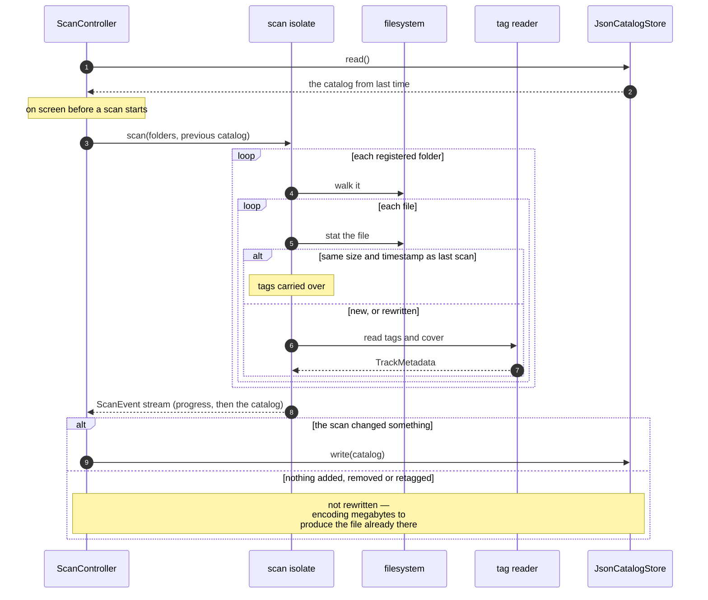

## What a scan is

A scan walks the folders the owner registered, reads the tags out of every audio
file it finds, extracts cover art, and writes the result as a single JSON
document beside the settings. That document is the library: it is read once at
launch and held in memory for the run.

Everything expensive about that is avoided wherever it can be, because on a
library of eleven thousand tracks the naive version makes every launch stutter.

## The two savings

**An unchanged file is carried over, not read.** Every scan stats every file —
the one at startup included — and a file with the same size and the same
timestamp as last time keeps the tags the catalog already holds, so only the
files that are new or were rewritten go to the tag reader. The stat is the cheap
part, and it is what makes a file a tagger rewrote *in place* show up: that
changes the file's own timestamp and not its folder's, and it is the change an
owner makes most.

**The catalog is not rewritten when nothing changed.** A scan that added,
updated and removed nothing carries every entry over from the stored document,
so writing it back encodes several megabytes to produce a file identical to the
one on disk.

## Off the interface's isolate

**Encoding and decoding happen on an isolate.** This costs more work in total —
spawning is not free, and the entries are copied back — and the point is where
the work lands. The interface's isolate pays for the message rather than for the
parse, and goes on drawing through it.

## Startup is never gated on a scan

The library from the last scan is on screen before a new scan is started. A
first launch shows an empty library and an invitation to add a folder; every
launch after that shows what was there last time, and the scan updates it
underneath.

## Cover art

Covers are cached by the hash of their own bytes, in a directory beside the
catalog. That makes the cache proportional to **distinct pictures** rather than
to files — a twelve-track album contributes one picture, not twelve — and it
means two records that happen to share artwork share one cached file.
